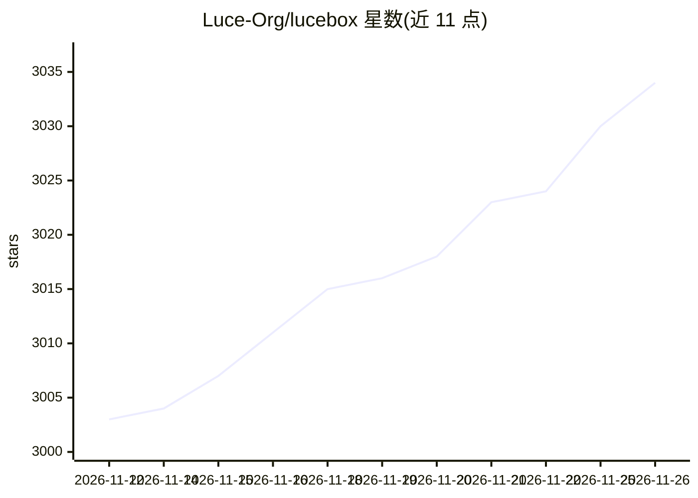

# Luce-Org/lucebox

⭐ 3,034 · C++ · Apache-2.0 · 推送 2026-11-25 · [GitHub](https://github.com/Luce-Org/lucebox) · [官网](https://www.lucebox.com) · 组织维护

**面向异构消费级硬件与 AMD GPU 的本地推理引擎**

Lucebox 是开源推理引擎，面向 AMD R9700 与 Ryzen AI MAX+ 两类芯片，支持单卡或同机双芯协同运行（注意力与活跃专家在 R9700，其余专家在 iGPU）。提供投机解码（DFlash2/MTP/DSpark）、分页注意力与连续批处理、前缀缓存、PFlash 长提示压缩与 KVFlash 分页缓存。兼容 OpenAI 与 Anthropic API，官方提供 ROCm 与 CUDA 预构建 Docker 镜像，Linux 下需 ROCm 7.2+ 并从源码 cmake 构建。

## 筛选速览

| 维度 | 判定 | 备注 |
|---|---|---|
| AI 角色 | `ai-ecosystem` | LLM/agent 周边工具 |
| 许可风险 | `permissive` | Apache-2.0 |
| 部署形态 | `self-host` | docker 或自建部署 |
| 模型依赖 | — | README 未给出锁定关系 |
| 硬件要求 | — | 无带数字的原话,不猜 |
| 安装摩擦 | `low` | 无编译、无系统依赖或容器化 |
| 成熟度 | — | 结构信号不足 |

## 能力要点

- 双芯协同：R9700 跑注意力/KV 缓存，iGPU 承载其余专家
- 投机解码：DFlash2、MTP、DSpark 覆盖所列各模型
- OpenAI Chat Completions/Responses 与 Anthropic Messages API 兼容
- PFlash 长提示压缩与 KVFlash 系统内存分页 KV 缓存

## 适用场景

- 在 R9700 与 Ryzen AI MAX+ 上本地部署 Qwen/DeepSeek 等模型
- 为编码 agent（Claude Code、Codex 等）提供本地推理后端
- 多用户并发本地推理服务（分页注意力与连续批处理）
- NVIDIA GPU 上以 CUDA 构建运行推理

## 场景标签

`推理引擎` · 领域:训练与推理

## 证据(README 行号)

> L14: Lucebox is an open-source inference engine for AMD's R9700 and Ryzen AI MAX+, on their own or together in one machi
> L33: - OpenAI Chat Completions and Responses, and the Anthropic Messages API
> L86: cmake -S server -B server/build-hip -DCMAKE_BUILD_TYPE=Release \

## 星数曲线

2026-11-12 3,003 → 2026-11-26 3,034（+31）

---
*卡片 v1 · prompt 1.4 · 生成 2026-11-24 · 置信度 high · 依据 README sha `0d964020acef` · [字段定义](../../DATASET.md)*
