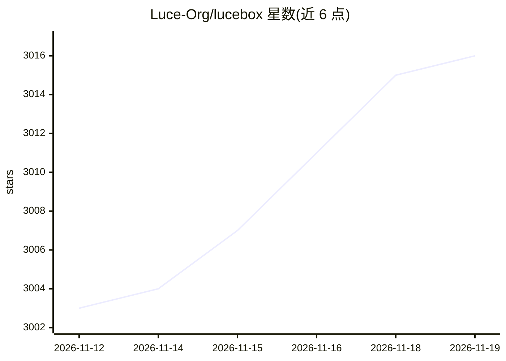

# Luce-Org/lucebox

⭐ 3,016 · C++ · Apache-2.0 · 推送 2026-11-18 · [GitHub](https://github.com/Luce-Org/lucebox) · [官网](https://www.lucebox.com) · 组织维护

**面向 AMD 消费级异构硬件的本地 LLM 推理引擎**

开源推理引擎，面向 Radeon AI PRO R9700（RDNA4）与 Ryzen AI MAX+（RDNA3.5 iGPU），支持单卡或将两颗芯片组成一台机器分摊模型（注意力/KV cache 在独显、路由专家在 iGPU）。运行 Qwen 3.8 系列、DeepSeek V4/V4.1 与 MOSS-Image，特性含投机解码（DFlash2/MTP）、Paged attention、连续批处理、PFlash 长提示压缩与 KVFlash KV cache 分页。提供 OpenAI 与 Anthropic 兼容 API，Claude Code、Codex 等编码 agent 可直连。需 Linux + ROCm 7.2 从源码 cmake 构建，另有 Docker 镜像与 NVIDIA CUDA 构建。

## 筛选速览

| 维度 | 判定 | 备注 |
|---|---|---|
| AI 角色 | `ai-ecosystem` | LLM/agent 周边工具 |
| 许可风险 | `permissive` | Apache-2.0 |
| 部署形态 | `self-host` | docker 或自建部署 |
| 模型依赖 | — | README 未给出锁定关系 |
| 硬件要求 | — | 无带数字的原话,不猜 |
| 安装摩擦 | `low` | 无编译、无系统依赖或容器化 |
| 成熟度 | — | 结构信号不足 |

## 能力要点

- 双芯片分工：R9700 跑注意力/KV cache，Ryzen AI MAX+ 承载路由专家
- 投机解码（DFlash2/MTP/DSpark）覆盖所列模型
- PFlash 长提示压缩（首 token 提前 3.7x）与 KVFlash KV cache 分页至系统内存
- OpenAI Chat/Responses 与 Anthropic Messages 兼容 API

## 适用场景

- 在 R9700 + Ryzen AI MAX+ 的机器上本地运行 Qwen/DeepSeek 模型
- 为 Claude Code、Codex 等编码 agent 提供本地推理后端
- 多用户共享部署（分页注意力 + 连续批处理）

## 场景标签

`推理引擎` · 领域:训练与推理

## 证据(README 行号)

> L14: Lucebox is an open-source inference engine for AMD's R9700 and Ryzen AI MAX+, on their own or together in one machi
> L33: - OpenAI Chat Completions and Responses, and the Anthropic Messages API

## 星数曲线

2026-11-12 3,003 → 2026-11-19 3,016（+13）

---
*卡片 v1 · prompt 1.4 · 生成 2026-11-17 · 置信度 high · 依据 README sha `c156ef0065c8` · [字段定义](../../DATASET.md)*
