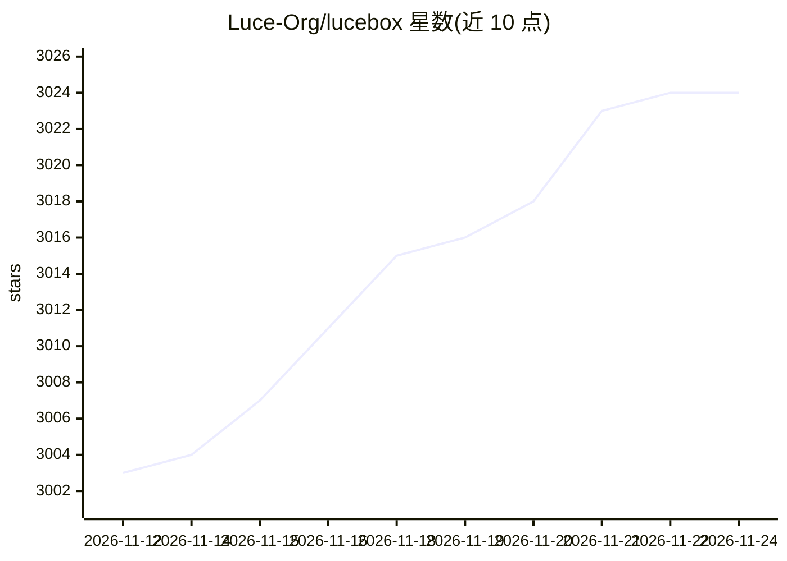

# Luce-Org/lucebox

⭐ 3,024 · C++ · Apache-2.0 · 推送 2026-11-22 · [GitHub](https://github.com/Luce-Org/lucebox) · [官网](https://www.lucebox.com) · 组织维护

**面向 AMD 消费级硬件的本地 LLM 推理引擎**

开源推理引擎，针对 Radeon AI PRO R9700 与 Ryzen AI MAX+ 两种 AMD 芯片设计，支持单芯片或两芯片协同作为一台机器运行（attention/KV cache 与专家分布在不同芯片）。运行 Qwen 3.8、DeepSeek V4/V4.1 与 MOSS-Image 等模型，提供投机解码（DFlash2/MTP/DSpark）、分页注意力、连续批处理、PFlash 长提示压缩与 KVFlash 系统内存 KV cache。兼容 OpenAI 与 Anthropic API，从源码以 CMake 构建编译，也可用 Docker 镜像运行，需 Linux 与 ROCm 7.2+。

## 筛选速览

| 维度 | 判定 | 备注 |
|---|---|---|
| AI 角色 | `ai-ecosystem` | LLM/agent 周边工具 |
| 许可风险 | `permissive` | Apache-2.0 |
| 部署形态 | `self-host` | docker 或自建部署 |
| 模型依赖 | locked-api |  |
| 硬件要求 | — | 无带数字的原话,不猜 |
| 安装摩擦 | `low` | 无编译、无系统依赖或容器化 |
| 成熟度 | — | 结构信号不足 |

## 能力要点

- 双芯片协同：R9700 与 Ryzen AI MAX+ 组合运行单个大模型
- 投机解码覆盖全部模型（DFlash2、MTP、DSpark）
- PFlash 长提示压缩与 KVFlash 系统内存 KV cache
- 兼容 OpenAI Chat/Responses 与 Anthropic Messages API

## 适用场景

- 在 AMD R9700 或 Ryzen AI MAX+ 上本地运行 Qwen、DeepSeek 等模型
- 为编码 Agent（Claude Code、Codex 等）提供本地推理后端
- 多用户共享一台消费级 GPU 推理服务器

## 场景标签

`推理引擎` · 领域:训练与推理

## 证据(README 行号)

> L14: Lucebox is an open-source inference engine for AMD's R9700 and Ryzen AI MAX+, on their own or together in one machi
> L33: - OpenAI Chat Completions and Responses, and the Anthropic Messages API

## 星数曲线

2026-11-12 3,003 → 2026-11-24 3,024（+21）

---
*卡片 v1 · prompt 1.4 · 生成 2026-11-23 · 置信度 high · 依据 README sha `9154a1dbd844` · [字段定义](../../DATASET.md)*
