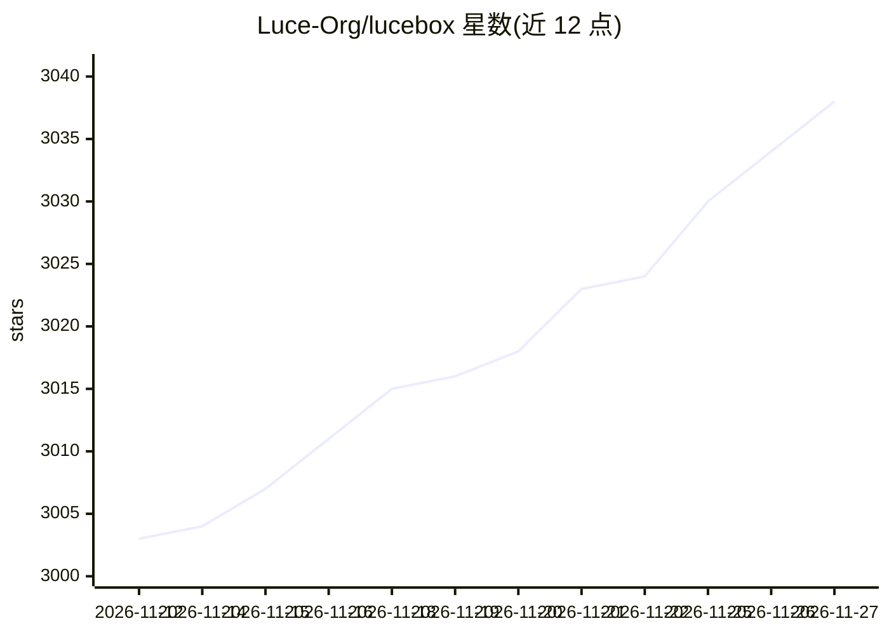

# Luce-Org/lucebox

⭐ 3,038 · C++ · Apache-2.0 · 推送 2026-11-26 · [GitHub](https://github.com/Luce-Org/lucebox) · [官网](https://www.lucebox.com) · 组织维护

**面向 AMD 消费级硬件的本地 LLM 推理引擎**

开源推理引擎，支持 AMD Radeon AI PRO R9700 与 Ryzen AI MAX+ 单独或同机协同运行，将注意力、KV cache 与专家层分配到两块芯片。提供投机解码（DFlash2/MTP/DSpark）、分页注意力与持续批处理、前缀缓存、PFlash 长提示压缩与 KVFlash 系统内存分页。兼容 OpenAI/Anthropic API，提供 HIP（RDNA4/RDNA3.5）与 CUDA 两种构建；需 Linux + ROCm 7.2+，从源码编译或使用预构建 Docker 镜像，另有搭载该引擎的 Lucebox Zero 整机。

## 筛选速览

| 维度 | 判定 | 备注 |
|---|---|---|
| AI 角色 | `ai-ecosystem` | LLM/agent 周边工具 |
| 许可风险 | `permissive` | Apache-2.0 |
| 部署形态 | `self-host` | docker 或自建部署 |
| 模型依赖 | locked-api |  |
| 硬件要求 | — | 无带数字的原话,不猜 |
| 安装摩擦 | `low` | 无编译、无系统依赖或容器化 |
| 成熟度 | — | 结构信号不足 |

## 能力要点

- 双芯片协同：R9700 跑注意力/KV cache/热点专家，iGPU 装其余专家
- 每个模型均配投机解码（DFlash2、MTP、DSpark）
- PFlash 长提示压缩与 KVFlash，decode 速度在 64K–256K token 保持平稳
- 内置 OpenAI Chat Completions/Responses 与 Anthropic Messages API

## 适用场景

- 在消费级 AMD 显卡与 iGPU 上本地运行大模型推理
- 为本地模型接入 Claude Code、Codex 等编码 agent
- 多用户共享一台本地推理服务器（分页注意力与并发控制）
- 处理超长上下文提示而不掉 decode 速度

## 场景标签

`推理引擎` · 领域:训练与推理

## 证据(README 行号)

> L14: Lucebox is an open-source inference engine for AMD's R9700 and Ryzen AI MAX+, on their own or together in one machi
> L79: You need Linux with ROCm 7.2 or newer. Only have one of the two chips? See one chip or another card.
> L88: cmake --build server/build-hip --target luce_server -j"$(nproc)"

## 星数曲线

2026-11-12 3,003 → 2026-11-27 3,038（+35）

---
*卡片 v1 · prompt 1.4 · 生成 2026-11-27 · 置信度 high · 依据 README sha `bdecc5001281` · [字段定义](../../DATASET.md)*
