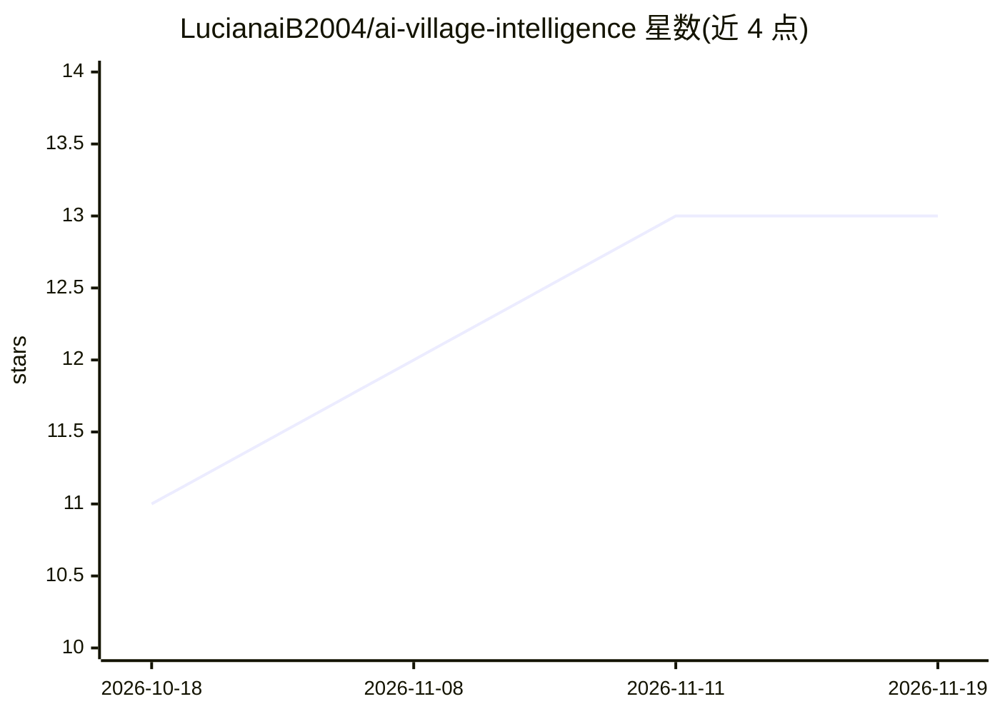

# LucianaiB2004/ai-village-intelligence

⭐ 13 · JavaScript · MIT · 推送 2026-08-23 · [GitHub](https://github.com/LucianaiB2004/ai-village-intelligence) · [官网](https://lucianaib.feishu.cn/wiki/HbOawBgMai2tI5kvSQIc7odlnbg) · 个人维护 · 中文 README

**个人 AI 情报日报与截止日期提醒系统，基于飞书**

由 AI Skill、飞书多维表格与飞书原生自动化组成的个人情报系统：AI 按用户配置的信息源搜索 AI 行业动态，去重、核验后生成日报写入飞书表格并定时推送；用户提交活动链接后，AI 提取标题与起止日期入库，飞书每天筛选未结束活动并按截止日期推送最近 5 条推荐。前置条件为 Node.js 20+、PowerShell、lark-cli 与支持 Skills 的 AI 客户端，通过让 AI 安装 SKILL.md 完成部署，含 37 项自动化测试与 MIT 协议。

## 筛选速览

| 维度 | 判定 | 备注 |
|---|---|---|
| AI 角色 | `ai-native` | 本体是模型或模型工具 |
| 许可风险 | `permissive` | MIT |
| 部署形态 | `None` |  |
| 模型依赖 | — | README 未给出锁定关系 |
| 硬件要求 | — | 无带数字的原话,不猜 |
| 安装摩擦 | `low` | 无编译、无系统依赖或容器化 |
| 成熟度 | — | 结构信号不足 |

## 能力要点

- AI 情报日报：按自定义信息源搜索、去重并保留来源链接
- 截止日期救命器：从活动链接提取日期并按截止时间推送提醒
- 基于飞书多维表格与工作流实现存储、筛选和定时触达
- Markdown 提示词文件可修改，自定义信息源与推荐规则

## 适用场景

- 每天自动收到一份 AI 行业动态日报
- 收藏比赛、黑客松链接后自动获得截止日期催办提醒
- 替换成自己信任的信息源建立个人情报组合

## 场景标签

`工作流自动化` · 领域:效率与自动化

## 证据(README 行号)

> L11: 《AI村口情报中心》是一套由 **AI、Skill、飞书多维表格和飞书原生自动化**共同运行的个人情报闭环。AI 负责搜索、理解、提取、判断、去重和生成；飞书负责数据存储、状态管理、定时筛选和主动触达。
> L29: - 根据用户配置的信息源和关注主题搜索 AI 行业动态。
> L50: - 飞书每天筛选尚未结束的活动，AI 按结束日期生成最近 5 条推荐。

## 星数曲线

2026-10-18 11 → 2026-11-19 13（+2）

---
*卡片 v1 · prompt 1.4 · 生成 2026-11-18 · 置信度 high · 依据 README sha `01871e891042` · [字段定义](../../DATASET.md)*
