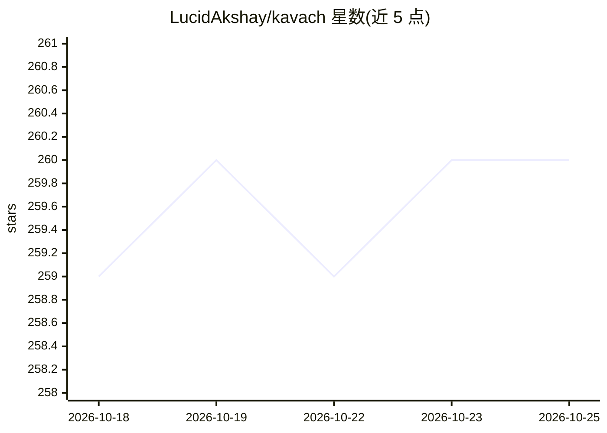

# LucidAkshay/kavach

⭐ 260 · TypeScript · GPL-3.0 · 推送 2026-03-19 · [GitHub](https://github.com/LucidAkshay/kavach) · 个人维护

**监控并约束本地 AI agent 与 LLM 的端点检测响应（EDR）桌面工具**

基于 Tauri + Rust + React 的开源 EDR 层，针对运行在本机的自主 AI agent 与本地 LLM：以 Userland 异步文件系统观察者方式监控指定工作区，将破坏性文件操作路由到隐藏幻影目录、60 秒未处置自动终止 agent 进程、50MB 以下文件加密缓存支持一键回滚、部署蜜罐诱饵文件、扫描外发字符串中的密钥/PII 并覆写剪贴板，同时提供哈希链审计日志与依赖 CVE 扫描。宣称零云依赖、完全本地运行。限制：v1.1 为监控层而非同步沙箱，系统调用级拦截需内核驱动，列入 v1.2 路线图。通过 Releases 安装包部署，Windows 进程终止需管理员权限。

## 筛选速览

| 维度 | 判定 | 备注 |
|---|---|---|
| AI 角色 | `ai-enhanced` | 去掉 AI 部分产品仍成立 |
| 许可风险 | `viral` | GPL-3.0 |
| 部署形态 | `desktop` | 安装包/桌面程序 |
| 模型依赖 | — | README 未给出锁定关系 |
| 硬件要求 | — | 无带数字的原话,不猜 |
| 安装摩擦 | `low` | 无编译、无系统依赖或容器化 |
| 成熟度 | `idea` | |

## 能力要点

- 破坏性文件操作拦截并路由到 .kavach_phantom 幻影目录
- 待处理动作超 60 秒自动向 agent 进程发送终止信号
- 50MB 以下文件加密缓存支持一键回滚
- 蜜罐诱饵文件触发 High Risk 锁定与 FNV 哈希链不可篡改审计日志

## 适用场景

- 防止本机 AI agent 误删源码、数据库或外泄密钥
- 对 agent 执行的文件操作做隔离、回滚与审计取证
- 实时扫描外发内容中的 API 密钥与 PII

## 场景标签

`网络安全` · 领域:学习与行业

## 证据(README 行号)

> L13: > **Kavach** (Sanskrit for "Armor") is an open source Endpoint Detection and Response (EDR) layer designed exclusiv
> L19: **Architecture Transparency:** Kavach v1.1.0 operates as a high performance asynchronous file system observer using

## 星数曲线

2026-10-18 259 → 2026-10-25 260（+1）

---
*卡片 v1 · prompt 1.4 · 生成 2026-10-22 · 置信度 mid · 依据 README sha `306036c62cbb` · [字段定义](../../DATASET.md)*
