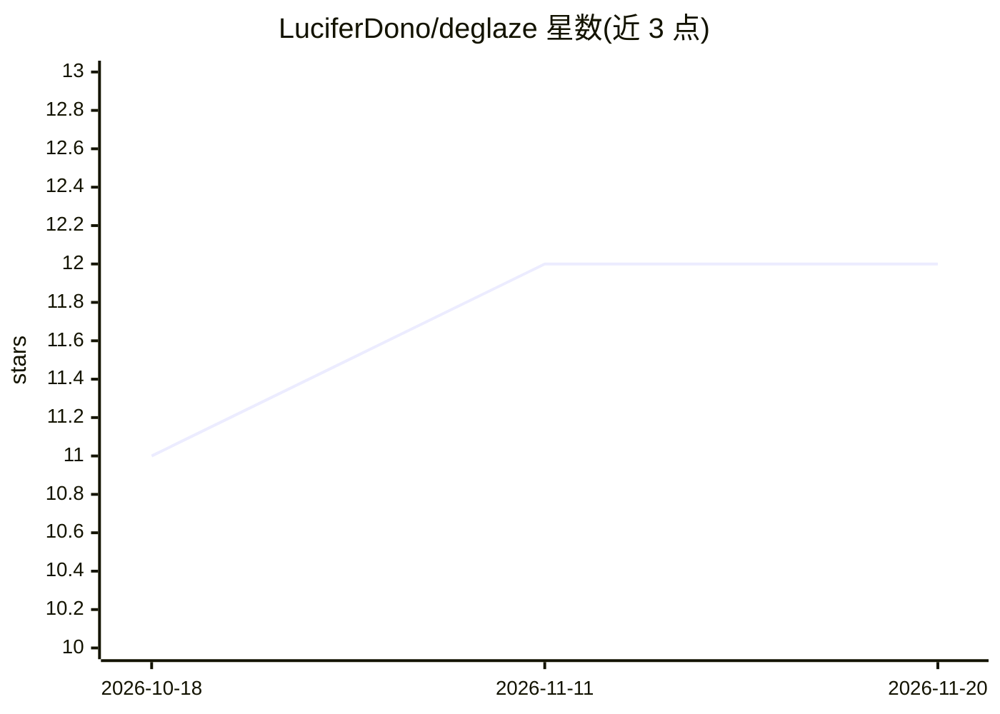

# LuciferDono/deglaze

⭐ 12 · MIT · 推送 2026-08-15 · [GitHub](https://github.com/LuciferDono/deglaze) · 个人维护

**让 AI 编码代理承认交付缺口的提示词审计技能**

一个纯 Markdown 的提示词技能：用户输入触发短语（如“did you do your best”或 /deglaze）后，模型按 17 种交付不足模式与 24 种施压技术自查最近的已完成声明，输出承认、缺口清单、失败模式诊断与恢复计划；若自查无缺口则须以 commit hash、文件路径、测试输出等证据反驳。以各平台封装分发到 Claude Code、Cursor、Codex CLI、GitHub Copilot、Google Antigravity 的规则目录，或粘贴进任意系统提示词。无代码、无依赖。

## 筛选速览

| 维度 | 判定 | 备注 |
|---|---|---|
| AI 角色 | `ai-native` | 本体是模型或模型工具 |
| 许可风险 | `permissive` | MIT |
| 部署形态 | `None` |  |
| 模型依赖 | locked-api |  |
| 硬件要求 | — | 无带数字的原话,不猜 |
| 安装摩擦 | `low` | 无编译、无系统依赖或容器化 |
| 成熟度 | — | 结构信号不足 |

## 能力要点

- 17 种命名交付不足模式 + 24 种施压技术的自查协议
- 支持 Claude Code / Cursor / Codex CLI / Copilot / Antigravity 及任意系统提示词模型
- 无缺口时要求以证据（commit、路径、运行输出）反驳而非罗列成绩
- 纯 Markdown 实现，无代码无依赖

## 适用场景

- AI 编码代理宣布任务完成后触发自查，核验实际交付
- 长会话结束时让模型枚举被跳过的子任务
- 给任意带系统提示词的 LLM 粘贴该协议做完工审计

## 场景标签

`提示工程` · 领域:Agent 开发

## 证据(README 行号)

> L5: A portable prompt-skill that makes Claude, Cursor, Codex, Copilot, Antigravity, and any other AI coding agent admit 
> L15: When you type a trigger phrase (anything in the shape of "did you do your best", "what did you skip", "stop glazing
> L170: **Is it just prompt engineering?**

## 星数曲线

2026-10-18 11 → 2026-11-20 12（+1）

---
*卡片 v1 · prompt 1.4 · 生成 2026-11-18 · 置信度 high · 依据 README sha `5e15f6391fdf` · [字段定义](../../DATASET.md)*
