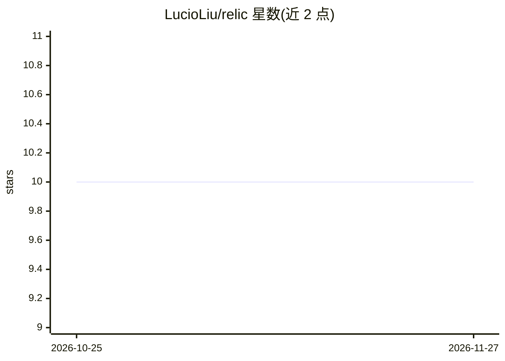

# LucioLiu/relic

⭐ 10 · NOASSERTION · 推送 2026-07-23 · [GitHub](https://github.com/LucioLiu/relic) · [官网](https://github.com/LucioLiu/relic) · 个人维护 · 中文 README

**用纯 Markdown 在多个 AI 工具间迁移人格与记忆**

以 brain/ 文件夹（SOUL.md、USER.md、MEMORY.md、SKILLS/、SESSIONS/ 等）存储 AI 助手的人格、偏好、长期记忆与技能，供 Hermes、Claude Code、Cursor、OpenClaw 等工具读取同一份数据。设置方式为 git clone 或 ZIP 下载后，由 AI 工具读取 AGENT.md 自动完成导入或注入；同步按只追加、保护核心字段、保留原始会话等规则约束，数据全部保留在本地。已知限制：技能文件因各工具格式不同可能不能跨平台直接移植。GPL v3 许可。

## 筛选速览

| 维度 | 判定 | 备注 |
|---|---|---|
| AI 角色 | `ai-ecosystem` | LLM/agent 周边工具 |
| 许可风险 | `none` | NOASSERTION |
| 部署形态 | `None` |  |
| 模型依赖 | — | README 未给出锁定关系 |
| 硬件要求 | — | 无带数字的原话,不猜 |
| 安装摩擦 | `low` | 无编译、无系统依赖或容器化 |
| 成熟度 | — | 结构信号不足 |

## 能力要点

- 纯 Markdown 文件存储人格/记忆/技能，零依赖、无云服务
- 多工具共享同一 soul，记忆双向同步
- 核心字段保护与 MEMORY.md 只追加等安全规则
- 提供各 AI 工具的集成示例文档

## 适用场景

- 在多个 AI 编程助手之间保留同一份偏好与记忆
- 为 AI 助手建立结构化长期记忆档案
- 本地保存与归档与 AI 的完整会话记录

## 场景标签

`Agent 记忆` · 领域:Agent 开发

## 证据(README 行号)

> L14: **Relic gives your AI a persistent soul that works across all AI tools.** Personality, memories, skills, and projec
> L24: **Relic fixes this.** One folder of text files. All your AI tools share the same soul and memories. No cloud servic

## 星数曲线

2026-10-25 10 → 2026-11-27 10（+0）

---
*卡片 v1 · prompt 1.4 · 生成 2026-11-20 · 置信度 high · 依据 README sha `f23caa9405ea` · [字段定义](../../DATASET.md)*
