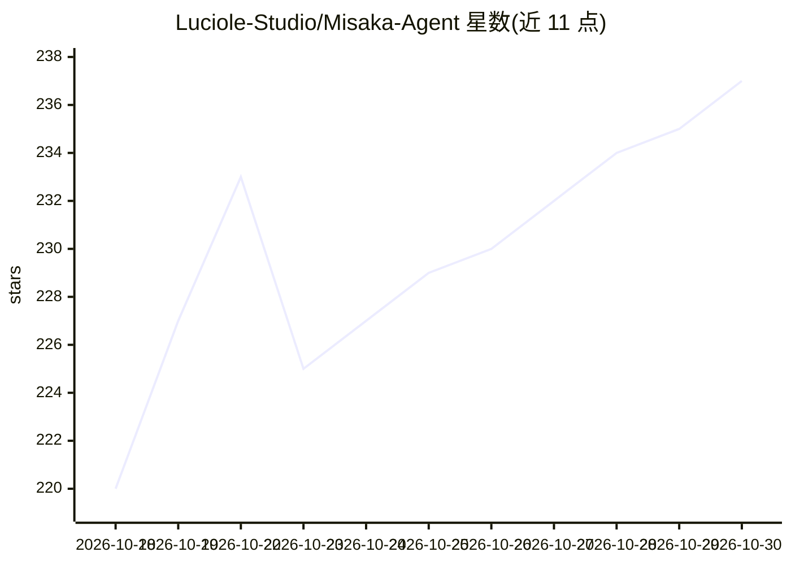

# Luciole-Studio/Misaka-Agent

⭐ 237 · Python · Apache-2.0 · 推送 2026-10-29 · [GitHub](https://github.com/Luciole-Studio/Misaka-Agent) · 组织维护 · 中文 README

**面向人文社科的多智能体研究系统，产出可溯源研究文章**

以 DAG 组织研究分支的多智能体系统：协调者 Last Order 拆解问题、制定研究计划，专业 Sister 智能体（可各配 Claude/GPT/Gemini 或本地模型）并行执行任务卡并汇报，红队以症状式阅读审查结论的遗漏与前提遮蔽，未覆盖方向开为新节点，逐层展开为研究图，最终在项目文件夹生成研究文章；引文可溯源到页码与字符偏移，计划、任务卡、结论各版本以 Markdown 存于 git 仓库。每节点经计划、卡片、结论、红队评审、回应、分歧审查、决策七阶段。面向人文社科研究者，需模型 API 或订阅账号。

## 筛选速览

| 维度 | 判定 | 备注 |
|---|---|---|
| AI 角色 | `ai-native` | 本体是模型或模型工具 |
| 许可风险 | `permissive` | Apache-2.0 |
| 部署形态 | `library` | 以包/库形式分发 |
| 模型依赖 | locked-api |  |
| 硬件要求 | — | 无带数字的原话,不猜 |
| 安装摩擦 | `low` | 无编译、无系统依赖或容器化 |
| 成熟度 | — | 结构信号不足 |

## 能力要点

- DAG 研究分支：每个未覆盖方向开为新节点，各配独立的 Last Order、Sisters 与红队
- 七阶段节点流程含红队评审与分歧审查，可回溯修订并记录勘误
- 引文溯源到页码与字符偏移，研究过程以 Markdown+git 仓库留档
- Sister 按技能分层加载，可各配不同模型（Claude/GPT/Gemini/本地模型）

## 适用场景

- 对人文社科研究问题做多假设、多方法的系统性文献研究
- 在用户逐步批准下展开研究计划并生成带完整引文的研究文章
- 审查研究结论中被前提遮蔽的未言明依赖并派生新研究方向

## 场景标签

`多智能体` `科研工具` · 领域:Agent 开发

## 证据(README 行号)

> L5:  Pairing a DAG with symptomatic reading to unearth plural narratives: an AI agent architecture built for the humanit
> L15: Break the question down with **Last Order**, the coordinator, and refine the research plan; send
> L86: Last Order, Sisters and red team. The run thus unfolds level by level into a research graph and

## 星数曲线

2026-10-18 220 → 2026-10-30 237（+17）

---
*卡片 v1 · prompt 1.4 · 生成 2026-10-22 · 置信度 mid · 依据 README sha `2534fa4e971a` · [字段定义](../../DATASET.md)*
