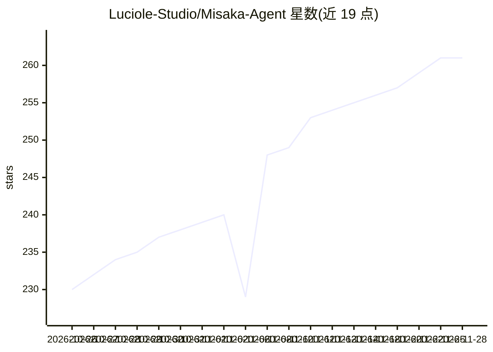

# Luciole-Studio/Misaka-Agent

⭐ 261 · Python · Apache-2.0 · 推送 2026-11-25 · [GitHub](https://github.com/Luciole-Studio/Misaka-Agent) · 组织维护 · 中文 README

**面向人文社科的多智能体研究系统，产出可溯源的研究文章**

MISAKA 以 Last Order 协调者拆解研究问题，将各分支交给专职的 Sisters 智能体并行检索与阅读，再经红队评审与分歧评审迭代结论，最终以研究文章形式写入项目文件夹，引用可溯源到页码与字符偏移。研究过程以 DAG 图管理，计划、结论各版本与批判均保存为 Markdown 并以 git 仓库记录。运行需用户提供模型 API key 或订阅，计划执行前须经用户批准。

## 筛选速览

| 维度 | 判定 | 备注 |
|---|---|---|
| AI 角色 | `ai-native` | 本体是模型或模型工具 |
| 许可风险 | `permissive` | Apache-2.0 |
| 部署形态 | `library` | 以包/库形式分发 |
| 模型依赖 | — | README 未给出锁定关系 |
| 硬件要求 | — | 无带数字的原话,不猜 |
| 安装摩擦 | `low` | 无编译、无系统依赖或容器化 |
| 成熟度 | — | 结构信号不足 |

## 能力要点

- Last Order + Sisters 多智能体分工， DAG 管理研究分支与汇合
- 红队评审与分歧评审（症候阅读）两类审查机制
- 引用可溯源至页码与字符偏移，过程文件以 git 仓库留档
- 支持 Claude/GPT/Gemini/本地模型及 Claude Code、Codex 协作

## 适用场景

- 对人文学科问题做多视角文献梳理并生成研究文章
- 需要每条结论附可溯源出处的研究流程
- 以红队评审方式审视研究结论的盲点与未言明前提

## 场景标签

`多智能体` `RAG` `科研工具` · 领域:Agent 开发

## 证据(README 行号)

> L5:  Pairing a DAG with symptomatic reading to unearth plural narratives: an AI agent architecture built for the humanit
> L15: Break the question down with **Last Order**, the coordinator, and refine the research plan; send
> L26:  A division of means and ends Each Sister brings her own specialty, skills and model (Claude, GPT, Gemini or a loca

## 星数曲线

2026-10-26 230 → 2026-11-28 261（+31）

---
*卡片 v1 · prompt 1.4 · 生成 2026-11-25 · 置信度 mid · 依据 README sha `e4f85939baf3` · [字段定义](../../DATASET.md)*
