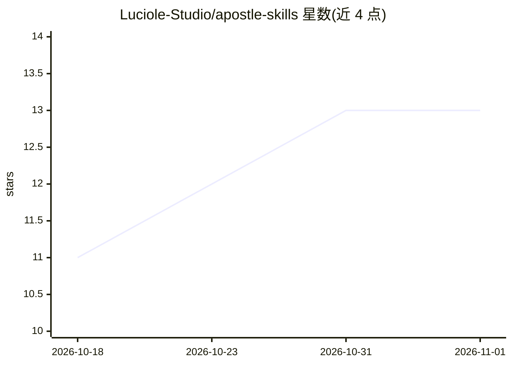

# Luciole-Studio/apostle-skills

⭐ 13 · AGPL-3.0 · 推送 2026-09-01 · [GitHub](https://github.com/Luciole-Studio/apostle-skills) · [官网](https://space.bilibili.com/1878125647) · 组织维护 · 中文 README

**面向 agent 的思考/阅读/研究/翻译技能集（11 个 SKILL.md）**

Luciole Studio 维护的 agent 技能合集：11 个自包含的 SKILL.md 格式技能，覆盖深思与反思（apostle-constitutio）、长程工作连续性、啃读艰深书籍、按方法论研读经典、文章研究、成书级翻译、去模型腔文风、规格驱动写代码等场景，并附按任务选载/跳过的加载表。作者主张 skill 属于 Prompt 一部分，随前沿模型更替需同步更新。采用 AGPL-3.0-or-later，支持 bunx skills 或直接拷贝 skills/<name>/ 目录安装。

## 筛选速览

| 维度 | 判定 | 备注 |
|---|---|---|
| AI 角色 | `ai-knowledge` | 知识聚合/清单类 |
| 许可风险 | `viral` | AGPL-3.0 |
| 部署形态 | `None` |  |
| 模型依赖 | — | README 未给出锁定关系 |
| 硬件要求 | — | 无带数字的原话,不猜 |
| 安装摩擦 | `low` | 无编译、无系统依赖或容器化 |
| 成熟度 | — | 结构信号不足 |

## 能力要点

- 11 个自包含 SKILL.md，覆盖思考、阅读、研究、翻译、写码场景
- 提供按任务匹配技能的加载/跳过表（L85-93）
- bunx skills@latest add 或直接拷贝目录两种安装方式
- AGPL-3.0-or-later 许可，允许 fork 与修改后网络服务使用（附源码义务）

## 适用场景

- 为 Claude 类 agent 按任务加载特定技能（如翻译整本书、啃读艰深论文）
- 在长程多阶段工作中让 Agent 记笔记保持连续性
- 清理中文/英文写作中的模型腔文风
- 以规格优先流程写代码（apostle-sdd）

## 场景标签

`提示工程` · 领域:Agent 开发

## 证据(README 行号)

> L3: skills.sh
> L81: format: one self-contained SKILL.md per skill

## 星数曲线

2026-10-18 11 → 2026-11-01 13（+2）

---
*卡片 v1 · prompt 1.4 · 生成 2026-10-31 · 置信度 high · 依据 README sha `9c3f5e0e64a9` · [字段定义](../../DATASET.md)*
