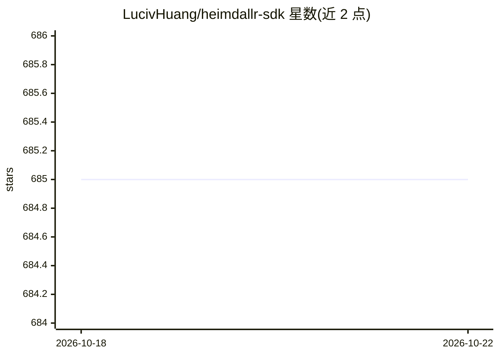

# LucivHuang/heimdallr-sdk

⭐ 685 · TypeScript · MIT · 推送 2026-08-22 · [GitHub](https://github.com/LucivHuang/heimdallr-sdk) · [官网](https://lucivhuang.github.io/heimdallr-sdk/) · 个人维护 · 中文 README

**插件化的前端埋点监控 SDK（错误/性能/行为采集）**

TypeScript 编写、Rollup 构建、monorepo 组织的前端监控 SDK，采用插件化可插拔架构：核心包 @heimdallr-sdk/browser 之外提供错误捕获、console、DOM、Fetch/XHR、路由、页面崩溃检测、性能指标、录屏、Vue 等插件。面向需要在前端应用中做埋点与监控的开发者。本地开发需 MySQL 与 RabbitMQ，通过 pnpm 安装依赖并用 Prisma 初始化数据库；提供基于 Playwright 的 E2E 测试套件。README 未展示具体的数据上报后端与 AI 相关功能细节。

## 筛选速览

| 维度 | 判定 | 备注 |
|---|---|---|
| AI 角色 | `ai-enhanced` | 去掉 AI 部分产品仍成立 |
| 许可风险 | `permissive` | MIT |
| 部署形态 | `library` | 以包/库形式分发 |
| 模型依赖 | — | README 未给出锁定关系 |
| 硬件要求 | — | 无带数字的原话,不猜 |
| 安装摩擦 | `low` | 无编译、无系统依赖或容器化 |
| 成熟度 | — | 结构信号不足 |

## 能力要点

- 插件化可插拔架构，覆盖错误捕获/性能指标/录屏/路由等 12 类插件
- monorepo 组织，支持按包（--filter）单独构建
- 基于 Playwright 的 E2E 测试套件（56 个用例）
- TypeScript 编写、Rollup 构建

## 适用场景

- 在前端应用中采集 JS 错误与性能指标
- 通过插件按需接入 Fetch/XHR、DOM、路由等行为埋点
- Vue 项目中集成监控与页面崩溃检测

## 场景标签

 · 领域:前端监控/可观测性

## 证据(README 行号)

> L1: HEIMDALLR-SDK
> L3: 首创插件化、可插拔的前端埋点 SDK · 简单易用、轻量化、插件化的前端监控利器

## 星数曲线

2026-10-18 685 → 2026-10-22 685（+0）

---
*卡片 v1 · prompt 1.4 · 生成 2026-10-21 · 置信度 low · 依据 README sha `427411a259d8` · [字段定义](../../DATASET.md)*
