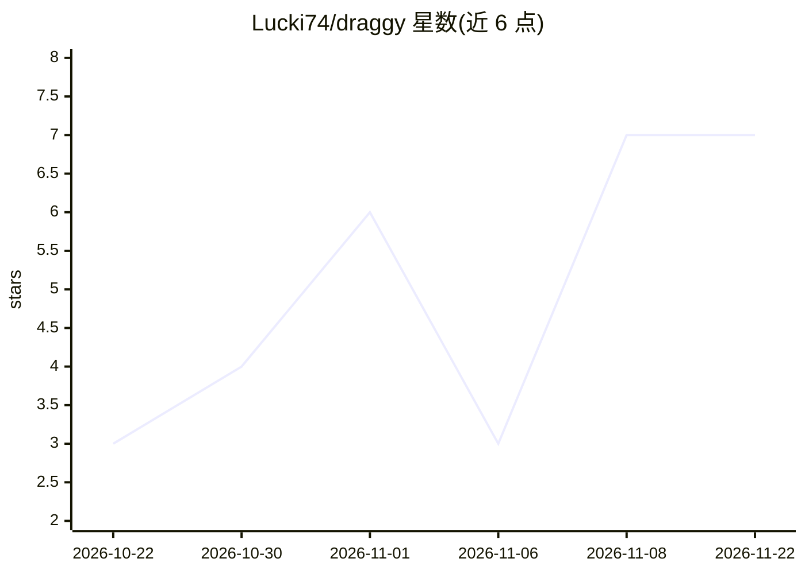

# Lucki74/draggy

⭐ 7 · Rust · Apache-2.0 · 推送 2026-11-21 · [GitHub](https://github.com/Lucki74/draggy) · [官网](https://draggy.org) · 个人维护

**跨平台本地 AI 助手与编码 Agent 桌面应用**

Draggy 是一款 Windows/macOS/Linux 桌面应用，通过内嵌 llama.cpp 引擎在本地运行 GGUF 开源模型，提供聊天、联网浏览与项目文件夹内操作。其编码 Agent 读取、编辑并执行项目内命令，所有改动以可撤销 diff 呈现，并在五种权限模式下运行。支持 CUDA/Metal/Vulkan/ROCm GPU 加速、MCP 服务器与 572 个内置技能、语音聊天、图像生成及兼容 OpenAI/Anthropic/Ollama 格式的本地 API。无账号、无遥测。

## 筛选速览

| 维度 | 判定 | 备注 |
|---|---|---|
| AI 角色 | `ai-native` | 本体是模型或模型工具 |
| 许可风险 | `permissive` | Apache-2.0 |
| 部署形态 | `desktop` | 安装包/桌面程序 |
| 模型依赖 | local-ok | 支持本地模型 |
| 硬件要求 | — | 无带数字的原话,不猜 |
| 安装摩擦 | `high` | 编译与系统依赖俱全 |
| 成熟度 | — | 结构信号不足 |

## 能力要点

- 本地运行 GGUF 模型，内嵌 llama.cpp 引擎，支持 CUDA/Metal/Vulkan/ROCm 加速
- 编码 Agent：项目内读改文件与执行命令，diff 可撤销，五种权限模式
- 支持 MCP 服务器与 572 个内置技能，本地 API 兼容 OpenAI/Anthropic/Ollama 格式
- 大 MoE 模型可从磁盘直接运行，低于 3 token/s 自动进入慢速模式

## 适用场景

- 在本地使用开源模型进行对话与深度研究
- 让编码 Agent 在项目文件夹内修改代码并审查 diff
- 通过 MCP 与内置技能扩展助手能力
- 以本地 API 为其他工具提供模型推理接口

## 场景标签

`编码 Agent` `AI 助手` `图像生成` `RAG` · 领域:编码与开发

## 证据(README 行号)

> L5: A local AI assistant and coding agent for Windows, macOS and Linux. Free, open source, no account.
> L20: Draggy is a desktop app that chats, browses the web and works in your project folders, with open models running on 
> L22: The models run locally through an embedded `llama.cpp` engine, with GGUF weights from Hugging Face. There's no acco

## 星数曲线

2026-10-22 3 → 2026-11-22 7（+4）

---
*卡片 v1 · prompt 1.4 · 生成 2026-11-20 · 置信度 high · 依据 README sha `e24e08b907fe` · [字段定义](../../DATASET.md)*
