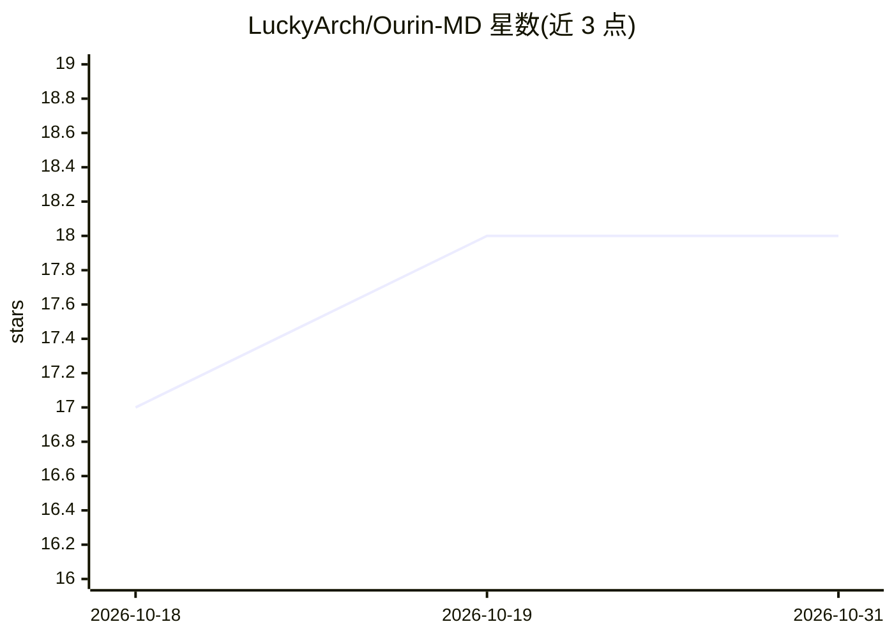

# LuckyArch/Ourin-MD

⭐ 18 · JavaScript · 推送 2026-02-16 · [GitHub](https://github.com/LuckyArch/Ourin-MD) · 个人维护

**基于 Baileys 的 WhatsApp 多设备机器人，模块化插件系统**

使用 Node.js 与 Baileys 库构建的 WhatsApp Multi-Device 机器人：通过 Pairing Code 与 WhatsApp 账号配对，会话保存在服务器/电脑端。功能包括模块化插件系统（每条命令为独立 JS 文件，可不重启增删）、LowDB 自动存档数据库、24 小时自动备份、自动重连、欢迎/欢送消息、Self/Public 双模式、反垃圾与拒接来电、贴纸制作、定时消息与每日限额。面向个人与群组用户，支持 Windows/Linux/macOS/Termux 运行，名称含 AI 但 README 未展示 AI 功能实现。

## 筛选速览

| 维度 | 判定 | 备注 |
|---|---|---|
| AI 角色 | `ai-enhanced` | 去掉 AI 部分产品仍成立 |
| 许可风险 | `none` | — |
| 部署形态 | `library` | 以包/库形式分发 |
| 模型依赖 | — | README 未给出锁定关系 |
| 硬件要求 | — | 无带数字的原话,不猜 |
| 安装摩擦 | `medium` | 含编译或系统依赖之一 |
| 成熟度 | — | 结构信号不足 |

## 能力要点

- 模块化插件系统，增删命令无需重启 bot
- Pairing Code 配对，多设备会话存于服务器端
- Self/Public 双模式、反垃圾、拒接来电与每日限额
- LowDB 自动存档与 24 小时自动备份（保留 7 天）

## 适用场景

- 在个人或群组 WhatsApp 中运行命令式机器人
- 把图片/视频转成 WhatsApp 贴纸
- 设置定时或每日重复发送消息
- 在 Android Termux 上零成本托管 bot

## 场景标签

 · 领域:即时通讯/机器人

## 证据(README 行号)

> L7: Halo! Selamat datang di OurinAI, sebuah bot WhatsApp yang dibangun dengan penuh cinta menggunakan Node.js. Bot ini d
> L38: OurinAI menggunakan library Baileys yang sudah teruji dan digunakan banyak developer. Ditambah sistem auto-reconnec

## 星数曲线

2026-10-18 17 → 2026-10-31 18（+1）

---
*卡片 v1 · prompt 1.4 · 生成 2026-10-29 · 置信度 low · 依据 README sha `51e728a0cfeb` · [字段定义](../../DATASET.md)*
