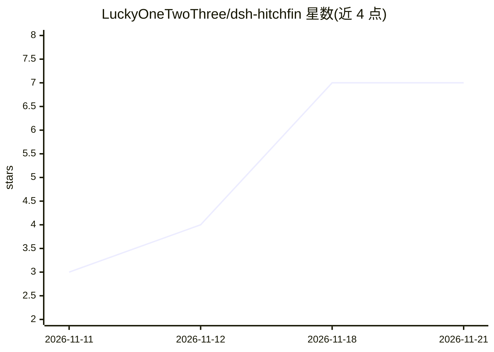

# LuckyOneTwoThree/dsh-hitchfin

⭐ 7 · TypeScript · MIT · 推送 2026-11-17 · [GitHub](https://github.com/LuckyOneTwoThree/dsh-hitchfin) · [官网](https://github.com/LuckyOneTwoThree/dsh-hitchfin#readme) · 个人维护 · 中文 README

**DSH 插件：将 WorkBuddy/Qoder/Trae 订阅账号接入 DeepSeek Harness**

一个 DSH（DeepSeek Harness）插件，把 WorkBuddy CN、Qoder CN、Trae CN 订阅账号注册为 DSH 原生模型供应商：通过官方账号浏览器登录或 API Key/PAT 登录后，账号有权的模型出现在 DSH 模型选择器中。功能覆盖多账号优先级与自动故障转移、按错误类型的失败冷却、账号级 HTTP(S) 代理、免费模型过滤与模型可见性管理。凭据保存在本机 DSH credential store，不做遥测。要求 DSH >= 0.2.2-rc.1 与 Node.js >= 20.18.1。

## 筛选速览

| 维度 | 判定 | 备注 |
|---|---|---|
| AI 角色 | `ai-ecosystem` | LLM/agent 周边工具 |
| 许可风险 | `permissive` | MIT |
| 部署形态 | `library` | 以包/库形式分发 |
| 模型依赖 | locked-api |  |
| 硬件要求 | — | 无带数字的原话,不猜 |
| 安装摩擦 | `low` | 无编译、无系统依赖或容器化 |
| 成熟度 | — | 结构信号不足 |

## 能力要点

- 多账号路由：主账号指定、故障转移顺序调整与会话粘滞
- 按错误类型（AUTH/QUOTA/RATE_LIMIT 等）设置差异化冷却时间
- 账号级 HTTP(S) 代理，仅作用于该账号的请求
- 免费模型过滤与逐模型可见性管理

## 适用场景

- 把已付费或免费使用的订阅套餐接入 DSH 模型选择器
- 为多个订阅账号配置故障转移与优先级
- 为特定账号配置独立代理
- 只使用免费模型时过滤付费模型

## 场景标签

`模型网关` · 领域:Agent 开发

## 证据(README 行号)

> L5:  把已经在用的 WorkBuddy、Qoder、Trae 订阅账号接进 DeepSeek Harness。
> L28: 插件把 WorkBuddy CN、Qoder CN、Trae CN 注册成 DSH 原生模型供应商。用官方账号登录后，账号有权的模型会直接出现在 DSH 模型选择器里。不共享账号、不自动签到、不绕过厂商限制。
> L28: 插件把 WorkBuddy CN、Qoder CN、Trae CN 注册成 DSH 原生模型供应商。用官方账号登录后，账号有权的模型会直接出现在 DSH 模型选择器里。不共享账号、不自动签到、不绕过厂商限制。

## 星数曲线

2026-11-11 3 → 2026-11-21 7（+4）

---
*卡片 v1 · prompt 1.4 · 生成 2026-11-20 · 置信度 high · 依据 README sha `46e41dcf3056` · [字段定义](../../DATASET.md)*
