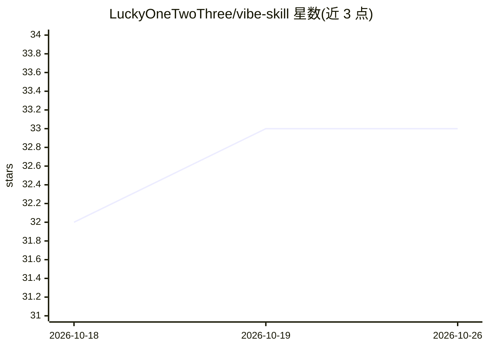

# LuckyOneTwoThree/vibe-skill

⭐ 33 · JavaScript · MIT · 推送 2026-06-20 · [GitHub](https://github.com/LuckyOneTwoThree/vibe-skill) · [官网](https://luckyonetwothree.github.io/all-skill-html/) · 个人维护 · 中文 README

**127 个覆盖产品全生命周期的 AI Agent 技能集（PM×UI×后端）**

将软件产品从 0 到 1 的方法论提取为 127 个 SKILL.md 格式的 AI Agent Skill，按 PM 产品方法论（106 个）、UI 设计与前端（9 个）、后端架构（10 个）、跨领域协调（2 个）组织。每个 Skill 是可独立执行的方法论 Pipeline，由编排器调度子 Skill 并在阶段卡口等待人类确认；领域间通过 PRD、OpenAPI 契约等 12+ 条数据契约衔接。兼容 Trae / Claude Code 的 Agent Skills 开放标准，部署方式为将 Skill 文件夹扁平复制到 .trae/skills/ 目录。

## 筛选速览

| 维度 | 判定 | 备注 |
|---|---|---|
| AI 角色 | `ai-knowledge` | 知识聚合/清单类 |
| 许可风险 | `permissive` | MIT |
| 部署形态 | `None` |  |
| 模型依赖 | — | README 未给出锁定关系 |
| 硬件要求 | — | 无带数字的原话,不猜 |
| 安装摩擦 | `low` | 无编译、无系统依赖或容器化 |
| 成熟度 | — | 结构信号不足 |

## 能力要点

- 127 个 Skill 分四大领域，含编排器/Pipeline/外部扩展三类角色
- 编排器在阶段卡口暂停等待人类审批的人机协作设计
- PRD/OpenAPI/设计令牌等跨领域数据契约衔接产品到实现全链路
- 兼容 Trae / Claude Code Agent Skills 开放标准，提供 codex 扁平化部署目标

## 适用场景

- 在 Trae 或 Claude Code 中按产品阶段调用对应方法论 Skill
- 用编排器串联从需求洞察到发布运营的完整产品流程
- 按需部署当前项目阶段所需的 Skill 子集

## 场景标签

`提示工程` · 领域:Agent 开发

## 证据(README 行号)

> L27: 将软件产品从 **0 到 1 的全生命周期方法论**，提取为 **127 个源 AI Agent Skill**，覆盖四大领域：
> L36: 兼容 Trae / Claude Code 的 Agent Skills 开放标准。每个 Skill 是一个可独立执行的方法论 Pipeline，编排器（Orchestrator）负责调度子 Skill 的执行顺序和阶段卡口。四大
> L57: 1. **全量部署**：将所有 `{skill-name}/` 文件夹复制到 `.trae/skills/` 下，扁平平铺

## 星数曲线

2026-10-18 32 → 2026-10-26 33（+1）

---
*卡片 v1 · prompt 1.4 · 生成 2026-10-25 · 置信度 high · 依据 README sha `786c2537aa1c` · [字段定义](../../DATASET.md)*
