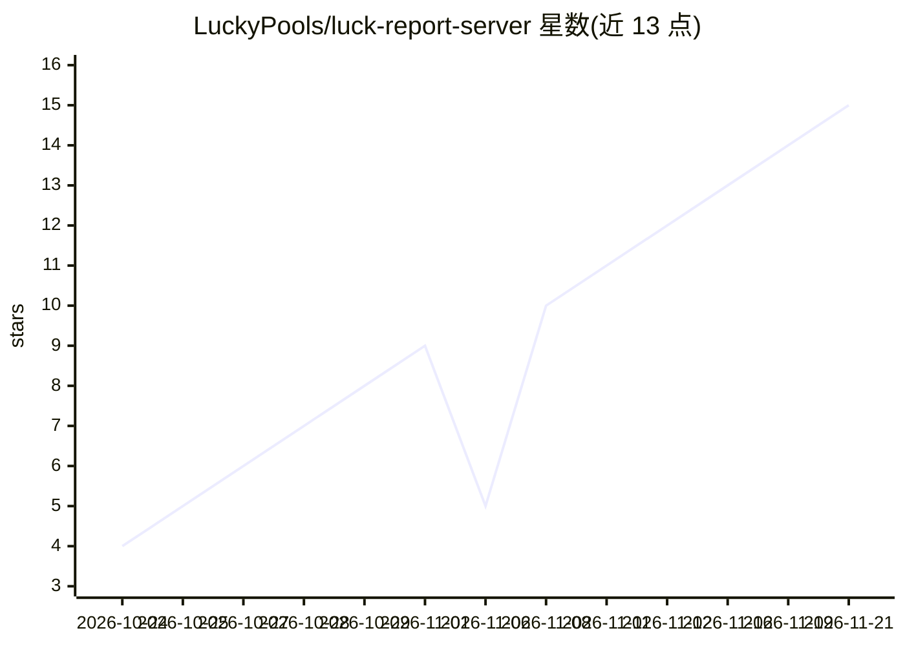

# LuckyPools/luck-report-server

⭐ 15 · Java · NOASSERTION · 推送 2026-11-16 · [GitHub](https://github.com/LuckyPools/luck-report-server) · 个人维护 · 中文 README

**内置 AI 助手的开源中国式复杂报表引擎**

面向中国式复杂报表的引擎，基于单元格迭代模型，在浏览器中完成交叉表、分组表、主从表、套打等版式的设计、预览与导出。内置 AI 智能助手，结合大模型配置与 RAG 知识库（PDF/Word/TXT/Markdown 向量化检索、多路召回与可选 Rerank）以自然语言制表、改表与答疑。后端为 Spring Boot，由开源 UReport2 重构而来，提供旧版报表迁移工具，支持通过 Starter 集成或独立部署。

## 筛选速览

| 维度 | 判定 | 备注 |
|---|---|---|
| AI 角色 | `ai-enhanced` | 去掉 AI 部分产品仍成立 |
| 许可风险 | `none` | NOASSERTION |
| 部署形态 | `None` |  |
| 模型依赖 | — | README 未给出锁定关系 |
| 硬件要求 | — | 无带数字的原话,不猜 |
| 安装摩擦 | `low` | 无编译、无系统依赖或容器化 |
| 成熟度 | — | 结构信号不足 |

## 能力要点

- 网页端可视化报表设计器与单元格迭代计算引擎
- AI 智能助手：自然语言制表、改表、答疑，支持深度思考
- RAG 知识库：多格式向量化检索、混合多路召回与可选 Rerank
- 导出 PDF/Word/Excel 与打印，10 种 ECharts 图表，角色权限管理

## 适用场景

- 在网页设计器中搭建交叉表、分组表等中国式复杂报表并导出
- 通过对话让 AI 助手生成或修改报表、解答报表问题
- 维护报表知识库辅助团队答疑
- 将报表引擎以 Starter 形式集成进已有 Java 后端项目

## 场景标签

`RAG` `数据分析` · 领域:效率与自动化

## 证据(README 行号)

> L10: Luck-Report 是一款面向**中国式复杂报表**的开源报表引擎。基于**单元格迭代**，可在浏览器中完成交叉表、分组表、主从表等复杂版式的设计、预览与导出。
> L12: Luck-Report 内置 **AI 智能助手**，可结合**大模型配置**与**知识库**，用自然语言完成制表、改表与答疑。后端基于 **Spring Boot**，支持独立部署。项目由开源 **UReport2** 重构而来
> L21: |AI 智能助手|自然语言制表、改表与答疑，支持深度思考|

## 星数曲线

2026-10-24 4 → 2026-11-21 15（+11）

---
*卡片 v1 · prompt 1.4 · 生成 2026-11-18 · 置信度 high · 依据 README sha `522cd253df26` · [字段定义](../../DATASET.md)*
