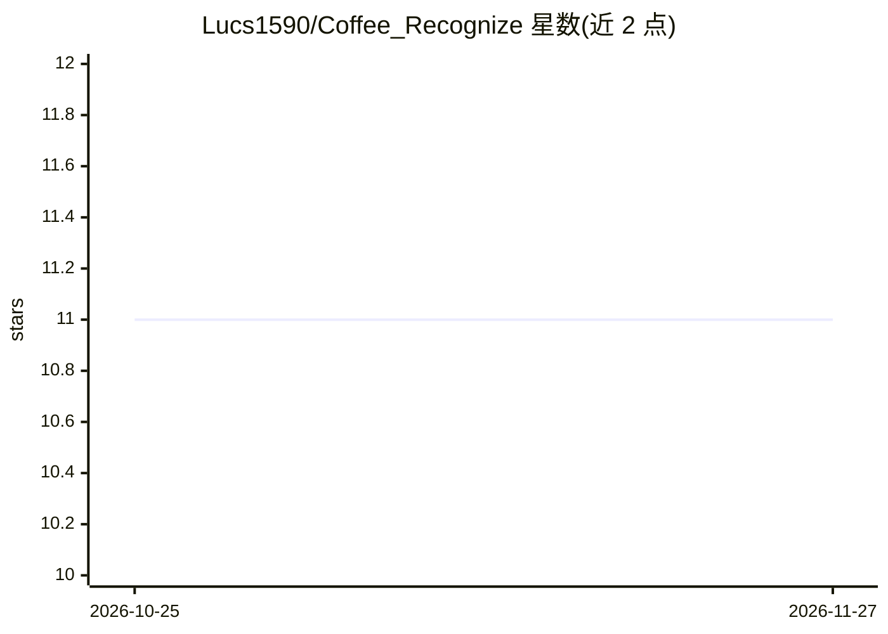

# Lucs1590/Coffee_Recognize

⭐ 11 · TypeScript · GPL-2.0 · 推送 2026-02-03 · [GitHub](https://github.com/Lucs1590/Coffee_Recognize) · 个人维护

**面向种植者的咖啡叶病害检测移动应用，量化感染比例**

毕业设计项目：检测咖啡叶片的锈病（Hemileia vastatrix）与潜叶蛾（Leucoptera coffeella）并量化感染程度。本仓库是整个系统的前端部分，即用户与模型推理之间的接口，为基于 Ionic/Cordova/Angular 的移动应用；模型推理由配套的 API 仓库（Coffee_Recognize_API）承担。据摘要，检测使用多种 CNN 架构目标检测器，结合 OpenCV、k-means 等方法对比病害严重度量化处理，报告平均检测精度 81.5%，并已注册巴西 INPI 计算机程序专利。

## 筛选速览

| 维度 | 判定 | 备注 |
|---|---|---|
| AI 角色 | `ai-native` | 本体是模型或模型工具 |
| 许可风险 | `viral` | GPL-2.0 |
| 部署形态 | `library` | 以包/库形式分发 |
| 模型依赖 | — | README 未给出锁定关系 |
| 硬件要求 | — | 无带数字的原话,不猜 |
| 安装摩擦 | `low` | 无编译、无系统依赖或容器化 |
| 成熟度 | — | 结构信号不足 |

## 能力要点

- 检测咖啡叶锈病与潜叶蛾并估计感染阶段
- 多种 CNN 架构的目标检测器，报告平均精度 81.5%
- Ionic/Cordova 移动应用界面，通过配套 API 调用模型推理
- 已在 INPI 注册计算机程序专利（BR512020002830-6）

## 适用场景

- 拍摄咖啡叶图像检测病害与感染程度
- 田间估算叶片病害严重度百分比

## 场景标签

`目标检测` · 领域:感知与多模态

## 证据(README 行号)

> L11: Pest and disease control play a key role in agriculture since the damage caused by these agents are responsible for
> L31: This is only a part of the whole project, with here, basically, the interface between the user and the model. An im

## 星数曲线

2026-10-25 11 → 2026-11-27 11（+0）

---
*卡片 v1 · prompt 1.4 · 生成 2026-11-19 · 置信度 high · 依据 README sha `846c6da2188d` · [字段定义](../../DATASET.md)*
