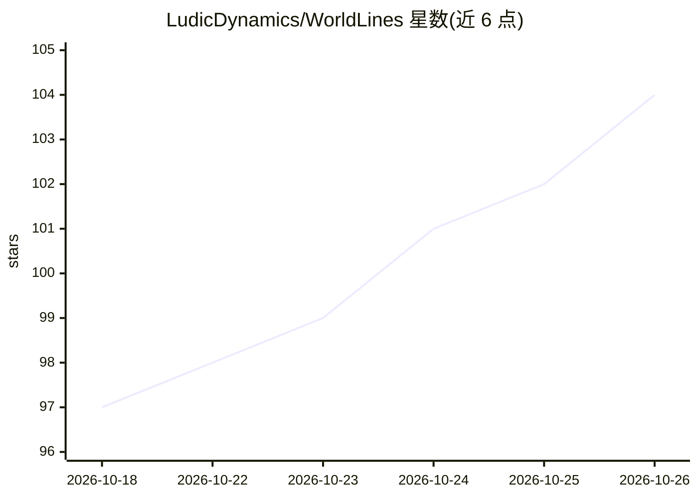

# LudicDynamics/WorldLines

⭐ 104 · Python · NOASSERTION · 推送 2026-10-24 · [GitHub](https://github.com/LudicDynamics/WorldLines) · [官网](https://worldlines.gg) · 组织维护 · 中文 README

**多 agent 实时模拟引擎：AI 角色各自有记忆与目标的可扮演角色扮演世界**

Ludic Dynamics 开发的多 agent 角色扮演模拟引擎：世界由 world-agent 编排一组 soul-agent，每个角色是独立 agent，拥有私有记忆、内心与目标；玩家通过 avatar 终端加入实时运行的多 agent 社会。引擎为文件存储、事件溯源架构，可回放与 git diff；模型无关，支持 DeepSeek/OpenRouter/本地模型。示例世界与工具以 AGPL-3.0 开源，引擎核心（neonrp）不开源可免费用；提供桌面安装包、终端安装脚本与浏览器在线游玩，并暴露 MCP 工具供 Claude Code 使用。多 agent 模式目前仅本地运行。

## 筛选速览

| 维度 | 判定 | 备注 |
|---|---|---|
| AI 角色 | `ai-native` | 本体是模型或模型工具 |
| 许可风险 | `none` | NOASSERTION |
| 部署形态 | `desktop` | 安装包/桌面程序 |
| 模型依赖 | — | README 未给出锁定关系 |
| 硬件要求 | — | 无带数字的原话,不猜 |
| 安装摩擦 | `low` | 无编译、无系统依赖或容器化 |
| 成熟度 | `idea` | |

## 能力要点

- world-agent + soul-agent 多 agent 社会架构，每个角色独立记忆与议程
- 文件存储、事件溯源、git 可 diff，可追踪回放与脚本化 JSON 输出
- 模型无关：DeepSeek / OpenRouter / 本地 / 免费模型均可运行
- 示例世界 AGPL-3.0 开源，agent 以 MCP 工具暴露给 Claude Code

## 适用场景

- 玩多角色 AI 角色扮演，角色跨会话记住我说过的话
- 作为 TRPG GM 设定规则后让 agent 代跑世界
- 研究者做多 agent 社会 / 人格模型实验的可复现沙盒
- 从公开目录挑选世界直接游玩或自建世界

## 场景标签

`Agent 框架` `多智能体` · 领域:Agent 开发

## 证据(README 行号)

> L22: > Most AI role-play gives you a *character to chat with*. WorldLines gives you a **world where every AI genuinely l
> L28: WorldLines is a **multi-agent simulation engine for role-play**: the world is a society of independent agents. A wo
> L46: > **Agent Role Play.** People already role-play directly inside Claude Code and Codex — letting an agentic system d

## 星数曲线

2026-10-18 97 → 2026-10-26 104（+7）

---
*卡片 v1 · prompt 1.4 · 生成 2026-10-23 · 置信度 high · 依据 README sha `65e7fef66546` · [字段定义](../../DATASET.md)*
