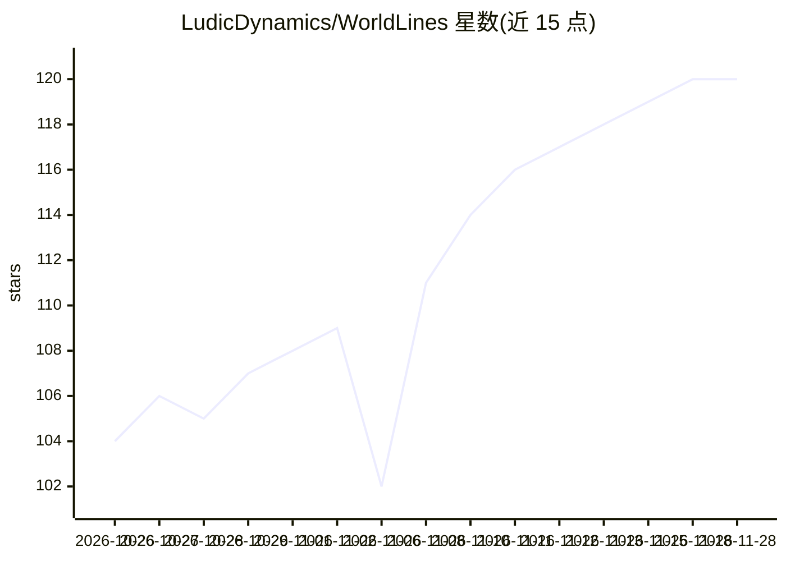

# LudicDynamics/WorldLines

⭐ 120 · Python · NOASSERTION · 推送 2026-10-26 · [GitHub](https://github.com/LudicDynamics/WorldLines) · [官网](https://worldlines.gg) · 组织维护 · 中文 README

**面向 AIRP 玩家的多智能体世界模拟/角色扮演引擎**

NeonRP 引擎 + WorldLines 产品：用多智能体编排运行 TRPG 式世界模拟，世界状态以 JSON/Markdown 文件存储，每回合一次可回滚或分支的提交；回合分 planning 与 resolve 两个节拍，由裁判判定对话是否落定，再掷骰并将校验后的变更写入世界。本地版以 PyPI 安装，自带 Web UI 与终端启动器，支持自带 API key 或账号中继；另提供 macOS/Windows 桌面应用。仓库（Apache-2.0/AGPL-3.0）与 PyPI 包存在闭源组件差异，桌面应用未签名/未公证。

## 筛选速览

| 维度 | 判定 | 备注 |
|---|---|---|
| AI 角色 | `ai-native` | 本体是模型或模型工具 |
| 许可风险 | `none` | NOASSERTION |
| 部署形态 | `library` | 以包/库形式分发 |
| 模型依赖 | — | README 未给出锁定关系 |
| 硬件要求 | — | 无带数字的原话,不猜 |
| 安装摩擦 | `low` | 无编译、无系统依赖或容器化 |
| 成熟度 | — | 结构信号不足 |

## 能力要点

- 世界状态为可 diff/回滚/分支的 JSON/Markdown 文件，每回合一次提交
- 回合分 planning/resolve 两节拍，含裁判裁定与骰子机制
- 编排为自然语言状态机（模板含 rpg/pct/werewolf/monopoly 及 economy/factions mixins）
- 模型不可绑定：支持 DeepSeek/OpenRouter/本地/OpenAI 兼容服务器

## 适用场景

- 玩有持久记忆与自主 NPC 的 AI 跑团角色扮演
- 为视觉小说/Galgame 实时生成可响应的剧情
- 作为 GM 工具运行带 NPC 记忆与自动索引的跑团世界
- 做多智能体社会实验与角色/世界模型基准

## 场景标签

`多智能体` · 领域:Agent 开发

## 证据(README 行号)

> L5: > **WorldLines — a multi-agent world-simulation engine built for you and your character agents.**
> L69: > **Agent Role Play.** People already role-play directly inside Claude Code and Codex — letting an agentic system d
> L105: pip install worldlines          # or: uv tool install worldlines — the product, with the neonrp engine

## 星数曲线

2026-10-26 104 → 2026-11-28 120（+16）

---
*卡片 v1 · prompt 1.4 · 生成 2026-11-28 · 置信度 high · 依据 README sha `2d4737eca662` · [字段定义](../../DATASET.md)*
