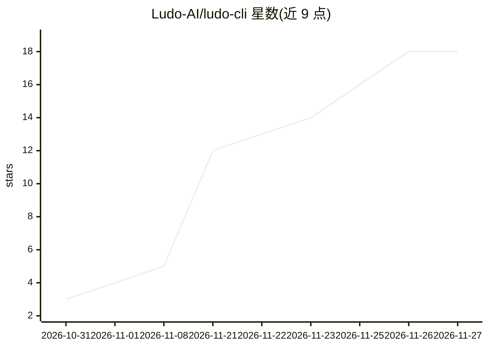

# Ludo-AI/ludo-cli

⭐ 18 · TypeScript · MIT · 推送 2026-11-26 · [GitHub](https://github.com/Ludo-AI/ludo-cli) · [官网](https://ludo.ai/developers/cli) · 组织维护

**给游戏开发者与编程代理的 AI 游戏资产生成 CLI**

通过终端或编程代理调用 Ludo AI 生成游戏素材：精灵图与序列帧动画、图片、带绑定与动画的 3D 模型、视频、音效、音乐与语音。生成结果保存到本地目录并附带资产日志，支持按 Godot/Unity/TexturePacker 引擎导出。另含 32 个完全离线、无需账号与 API key 的免费工具（切片精灵图、碰撞检测、音频检查等）。支持成本控制（--dry-run、消费预算）、变化批次生成与 CLI 内注册/付费流程。

## 筛选速览

| 维度 | 判定 | 备注 |
|---|---|---|
| AI 角色 | `ai-native` | 本体是模型或模型工具 |
| 许可风险 | `permissive` | MIT |
| 部署形态 | `library` | 以包/库形式分发 |
| 模型依赖 | — | README 未给出锁定关系 |
| 硬件要求 | — | 无带数字的原话,不猜 |
| 安装摩擦 | `low` | 无编译、无系统依赖或容器化 |
| 成熟度 | — | 结构信号不足 |

## 能力要点

- 图像/精灵/3D 模型/视频/音频全类游戏资产生成命令组
- 32 个离线免费工具，无需账号、API key 或点数
- 按引擎导出：Godot SpriteFrames、Unity .meta/.anim、TexturePacker JSON
- 成本控制：--dry-run、--max-credits 与项目级消费预算

## 适用场景

- 为 Godot/Unity/Phaser 项目生成并直接导出可用的精灵动画
- 让 Claude Code 等编程代理代为调用资产生成命令
- 离线切片与检查现有精灵图和音频素材

## 场景标签

`图像生成` `视频生成` · 领域:内容生成

## 证据(README 行号)

> L3: Generate game assets with Ludo AI from your terminal or from a coding agent:
> L8: npm install -g @ludoai/cli      # or run without installing: npx @ludoai/cli ...
> L129: `ludo toolbox` holds tools that run on your machine: offline, with no account, no API key and no

## 星数曲线

2026-10-31 3 → 2026-11-27 18（+15）

---
*卡片 v1 · prompt 1.4 · 生成 2026-11-21 · 置信度 high · 依据 README sha `7be25152ef4c` · [字段定义](../../DATASET.md)*
