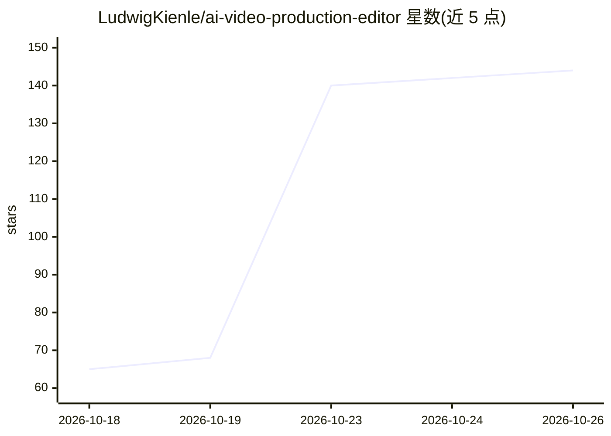

# LudwigKienle/ai-video-production-editor

⭐ 144 · TypeScript · GPL-3.0 · 推送 2026-10-25 · [GitHub](https://github.com/LudwigKienle/ai-video-production-editor) · [官网](https://github.com/LudwigKienle/ai-video-production-editor/releases/latest) · 个人维护

**本地优先的开源 AI 视频制作桌面工作站，覆盖剧本到成片**

Electron + React 构建的桌面应用（GPL-3.0），把 AI 视频制作流程整合在一个项目文件夹内：剧本、导演处理、分镜、图像/视频生成、剪辑、调色与导出。用户自带 API key 接入 fal.ai、Replicate、Gemini、xAI、ElevenLabs、Runway 等云服务，也可通过 Ollama/LM Studio/ComfyUI 全本地离线运行。提供 3D 预览（Hunyuan3D/Trellis/Rodin）、Studio Agent 自动跑流程、插件从 GitHub 安装。云服务依赖外部 key，adapters 为维护中的集成点而非永久契约。

## 筛选速览

| 维度 | 判定 | 备注 |
|---|---|---|
| AI 角色 | `ai-native` | 本体是模型或模型工具 |
| 许可风险 | `viral` | GPL-3.0 |
| 部署形态 | `desktop` | 安装包/桌面程序 |
| 模型依赖 | local-ok | 支持本地模型 |
| 硬件要求 | — | 无带数字的原话,不猜 |
| 安装摩擦 | `low` | 无编译、无系统依赖或容器化 |
| 成熟度 | — | 结构信号不足 |

## 能力要点

- 剧本→导演→分镜→拍摄→剪辑→调色→导出的单一流水线，Studio Agent 可代跑各阶段
- 按镜头自动路由模型（图像、视频、3D、音频多家引擎）
- 本地 AI 工作区：Ollama/LM Studio 跑文本，ComfyUI 跑开源权重图像视频模型，免 key 离线可用
- DaVinci 风格后期页面、色彩轮导出 LUT、离线自动剪辑（静音/场景/填充词检测）

## 适用场景

- 用 AI 生成图像与视频镜头并完成剪辑调色导出
- 全本地离线跑剧本、分镜与生成流程，不使用云 API key
- 用 3D 场景图和预演（previs）规划镜头运动后再生成视频

## 场景标签

`视频生成` `图像生成` · 领域:内容生成

## 证据(README 行号)

> L3:  An open-source, local-first film studio for AI video: script → director → storyboard → filming → edit → color → exp
> L21: grade and the export live in one project folder you own. Bring your own keys
> L22: for fal.ai, Replicate, Gemini, xAI, ElevenLabs and Runway; route every shot to

## 星数曲线

2026-10-18 65 → 2026-10-26 144（+79）

---
*卡片 v1 · prompt 1.4 · 生成 2026-10-23 · 置信度 high · 依据 README sha `178d38c98f8a` · [字段定义](../../DATASET.md)*
