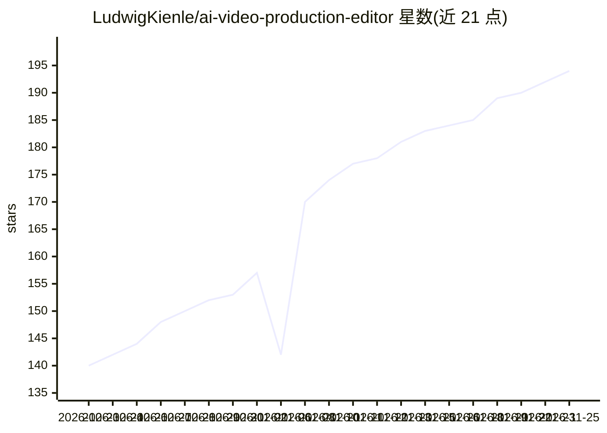

# LudwigKienle/ai-video-production-editor

⭐ 194 · TypeScript · GPL-3.0 · 推送 2026-11-20 · [GitHub](https://github.com/LudwigKienle/ai-video-production-editor) · [官网](https://github.com/LudwigKienle/ai-video-production-editor/releases/latest) · 个人维护

**面向电影人与 AI 艺术家的本地 AI 视频制作工作站**

基于 Electron + React 的桌面应用，覆盖剧本→导演处理→分镜→生成→剪辑→调色→导出的制作流程。接入 fal.ai、Replicate、Gemini、xAI、ElevenLabs、Runway 等云服务（BYOK），并支持通过 Ollama、LM Studio、ComfyUI、Draw Things 在本地运行开源模型。项目存储为本地文件夹，密钥保存在本机；GPL-3.0 核心，提供 macOS/Windows 安装包，开发者可通过 npm 从源码运行。

## 筛选速览

| 维度 | 判定 | 备注 |
|---|---|---|
| AI 角色 | `ai-native` | 本体是模型或模型工具 |
| 许可风险 | `viral` | GPL-3.0 |
| 部署形态 | `desktop` | 安装包/桌面程序 |
| 模型依赖 | local-ok | 支持本地模型 |
| 硬件要求 | — | 无带数字的原话,不猜 |
| 安装摩擦 | `low` | 无编译、无系统依赖或容器化 |
| 成熟度 | — | 结构信号不足 |

## 能力要点

- 一条制作流水线：剧本→导演→分镜→拍摄→审校→剪辑→调色→交付，含可代跑各阶段的 Studio Agent
- 按镜头内容自动或手动路由到不同图像/视频模型（Auto 模式）
- Local AI：本地 LLM 与 ComfyUI 开源图像/视频模型，一键下载、可离线
- DaVinci 风格后期页面：调色轮、波形/直方图、离线自动剪辑（静音/场景/口癖词）

## 适用场景

- 用 AI 生成分镜与镜头素材并完成剪辑调色
- 无需付费订阅、自带 API key 在本机跑完整制作流程
- 把参考图转 3D blockout 生成运动参考再喂给视频生成
- 通过 MCP 让 Claude Code/Codex 从外部读写剧本与分镜并触发生成

## 场景标签

`图像生成` `视频生成` · 领域:内容生成

## 证据(README 行号)

> L3:  An open-source, local-first film studio for AI video: script → director → storyboard → filming → edit → color → exp
> L33: |**Best model per shot**|Pick a model, or choose **Auto** and let the studio route people to Nano Banana / GPT Imag
> L83:  - Local LLMs (Ollama, LM Studio or any OpenAI-compatible server) answer the

## 星数曲线

2026-10-23 140 → 2026-11-25 194（+54）

---
*卡片 v1 · prompt 1.4 · 生成 2026-11-25 · 置信度 high · 依据 README sha `89d712bbc772` · [字段定义](../../DATASET.md)*
