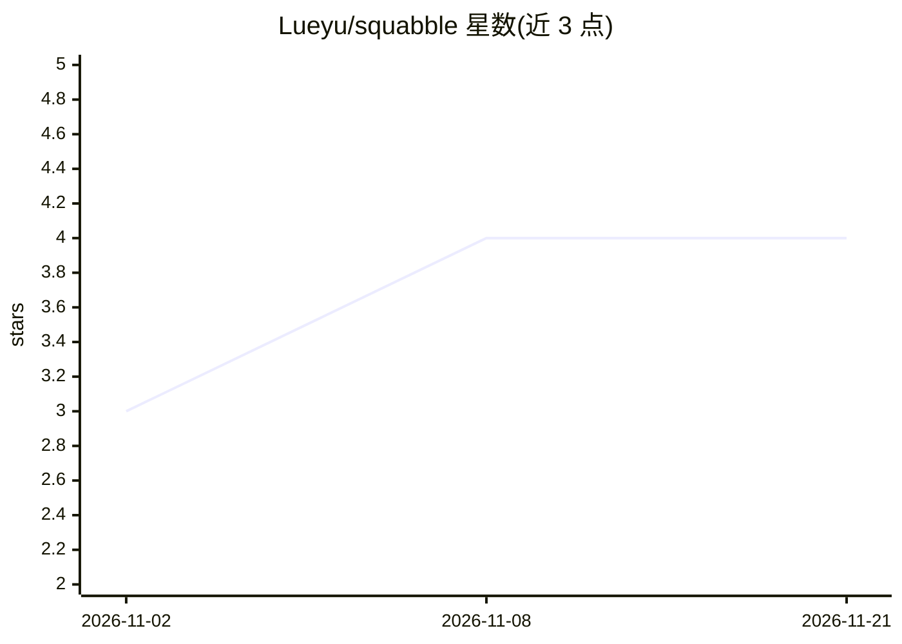

# Lueyu/squabble

⭐ 4 · TypeScript · MIT · 推送 2026-11-20 · [GitHub](https://github.com/Lueyu/squabble) · 个人维护 · 中文 README

**给个人投资者的开源投研工作台：AI 多代理辩论研究+模拟交易**

开源投资工作台，覆盖美/港/A股持仓跟踪、每日多代理牛熊辩论研究（14 节报告、保留败方论点）、带硬性风控的 AI 模拟交易与版本化研究记忆。可接入本地代理或模型 API，支持 Codex/Claude Code/Gemini CLI/Kimi/豆包 CLI 等原生代理连接，并提供 MCP 代理接入；持仓支持 CSV 与截图识别导入。桌面安装包内置 PostgreSQL，也可 Docker 自托管或源码运行，默认无外部遥测。

## 筛选速览

| 维度 | 判定 | 备注 |
|---|---|---|
| AI 角色 | `ai-native` | 本体是模型或模型工具 |
| 许可风险 | `permissive` | MIT |
| 部署形态 | `desktop` | 安装包/桌面程序 |
| 模型依赖 | locked-api |  |
| 硬件要求 | — | 无带数字的原话,不猜 |
| 安装摩擦 | `low` | 无编译、无系统依赖或容器化 |
| 成熟度 | — | 结构信号不足 |

## 能力要点

- 多代理牛熊辩论研究：critic 审查、风险门控、14 节版本化报告
- 带风控限制的 AI 模拟交易（日亏损熔断、单笔上限）与手动/MCP 代理下单
- 持久化代理与可编排投资团队画布（10 个可编辑模板）
- 支持 Codex/Claude Code/Gemini CLI/Kimi/豆包 CLI 等本地代理接入

## 适用场景

- 跟踪美/港/A股持仓并每天收到带出处的投研报告
- 用多个 AI 代理组成投资团队做模拟交易验证策略
- 导入券商 CSV 或截图批量识别持仓
- 自托管部署，数据留在本机

## 场景标签

`金融量化` `多智能体` · 领域:Agent 开发

## 证据(README 行号)

> L9: An open-source investing workspace.
> L80: |**AI research**|Bull-bear debate, critic review, risk gates. 14-section report. Versioned, with losing arguments k
> L98: Open **Settings → Local research agents** to use Codex, Claude Code, Gemini CLI,

## 星数曲线

2026-11-02 3 → 2026-11-21 4（+1）

---
*卡片 v1 · prompt 1.4 · 生成 2026-11-21 · 置信度 high · 依据 README sha `0fb09735cd0c` · [字段定义](../../DATASET.md)*
