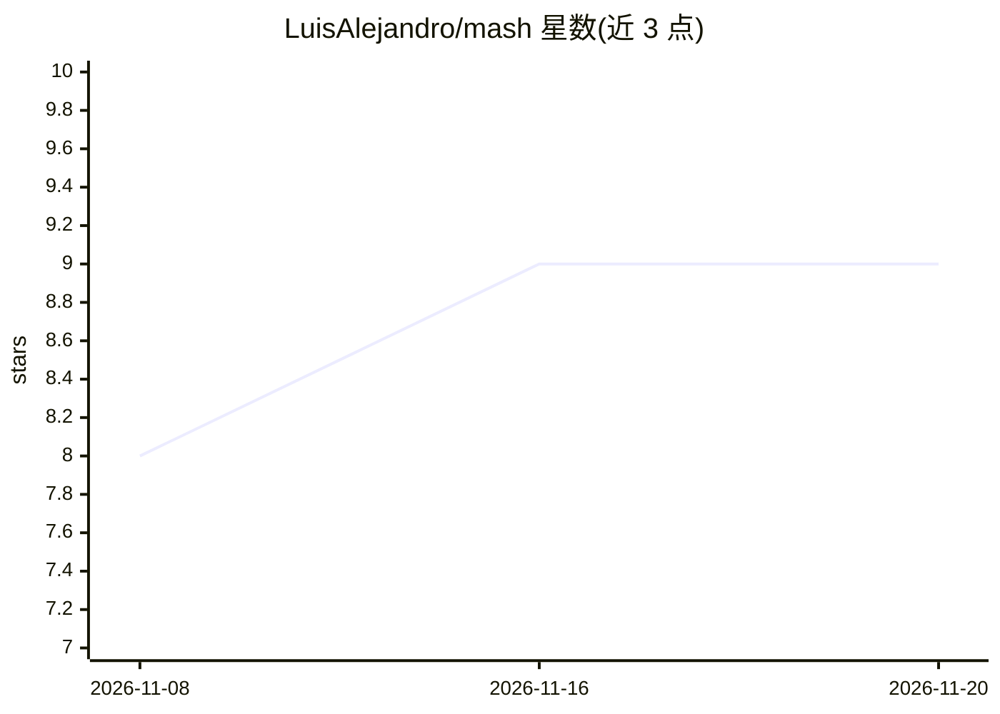

# LuisAlejandro/mash

⭐ — · [GitHub]() · 个人维护

**面向 AI 辅助编码的开发者桌面工作区应用**

Mash 将定制 Ghostty 终端、Herdr 工作区、Fresh 编辑器、Pi 与固定的开发工具整合为单一桌面应用，设置与会话集中存放在 ~/.mash，与外部工具隔离。提供 macOS DMG 与 Linux deb 安装包，首次启动由设置向导配置工作区，应用界面支持 15 种语言（含简体中文）。仅支持 macOS 14+（Apple silicon 与 Intel）与 Ubuntu 24.04 GNOME 环境；Intel 构建支持至 2027 年 9 月。

## 筛选速览

| 维度 | 判定 | 备注 |
|---|---|---|
| AI 角色 | `ai-enhanced` | 去掉 AI 部分产品仍成立 |
| 许可风险 | `viral` | — |
| 部署形态 | `desktop` | 安装包/桌面程序 |
| 模型依赖 | — | README 未给出锁定关系 |
| 硬件要求 | — | 无带数字的原话,不猜 |
| 安装摩擦 | `low` | 无编译、无系统依赖或容器化 |
| 成熟度 | `idea` | |

## 能力要点

- 整合 Ghostty 终端、Herdr 工作区、Fresh 编辑器与 Pi 于单一应用
- 设置与会话集中于 ~/./.mash 目录，升级保留用户配置
- 界面支持 15 种语言，含简体中文
- 安装包附带 SHA-256 校验，支持自动更新

## 适用场景

- 在统一桌面环境中运行终端、编辑器与编码 agent
- 同时使用多个 AI 编码工具并集中管理配置
- 在 macOS/Linux 上安装开箱即用的开发工作区

## 场景标签

 · 领域:开发者工具/集成开发环境

## 证据(README 行号)

> L3: *Mash* is a desktop workspace for AI-assisted coding. It brings a customized Ghostty terminal, Herdr workspaces, the
> L9: |Platform|Release asset|Supported environment|

## 星数曲线

2026-11-08 8 → 2026-11-20 9（+1）

---
*卡片 v1 · prompt 1.4 · 生成 2026-11-20 · 置信度 high · 依据 README sha `c5794bfbbbf5` · [字段定义](../../DATASET.md)*
