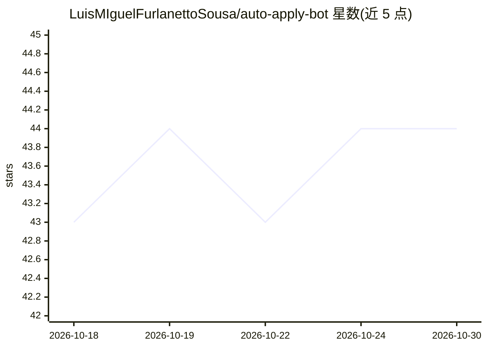

# LuisMIguelFurlanettoSousa/auto-apply-bot

⭐ 44 · TypeScript · MIT · 推送 2026-07-08 · [GitHub](https://github.com/LuisMIguelFurlanettoSousa/auto-apply-bot) · 个人维护

**用 Gemini 驱动浏览器自动投递求职申请的 AI agent**

TypeScript 编写的求职自动化 agent：以 Google Gemini 为决策核心，通过 Playwright MCP 经 CDP 控制用户已登录的 Chrome，在 Gupy、LinkedIn、Indeed 等招聘门户浏览职位、按评分规则筛选（1-10 分 + 黑名单/语言等淘汰项）、自动填写表单并生成逐岗位定制的简历与求职信（含防捏造校验）。提供 dry-run 模式、Telegram 通知、Web 仪表盘、SQLite 防重复与回答缓存、多 LLM 后端（Ollama/OpenAI 兼容）。README 自述尚未端到端验证，反爬与 CAPTCHA 为主要障碍，须人工经 Telegram 介入；使用已登录账号自动化违反门户 ToS。

## 筛选速览

| 维度 | 判定 | 备注 |
|---|---|---|
| AI 角色 | `ai-native` | 本体是模型或模型工具 |
| 许可风险 | `permissive` | MIT |
| 部署形态 | `library` | 以包/库形式分发 |
| 模型依赖 | local-ok | 支持本地模型 |
| 硬件要求 | — | 无带数字的原话,不猜 |
| 安装摩擦 | `low` | 无编译、无系统依赖或容器化 |
| 成熟度 | `idea` | |

## 能力要点

- Gemini + Playwright MCP 复用已登录 Chrome 会话执行投递流程
- 逐岗位生成定制简历（HTML→PDF）与求职信，带防捏造校验和缓存
- 评分门控与 DRY_RUN 注册门在代码层面拒绝低分/黑名单岗位
- 支持 Ollama/OpenAI 兼容 API 作为辅助 LLM 后端

## 适用场景

- 我想自动化在多个招聘网站填写表单和投递
- 按技术匹配度和地点条件自动筛选职位再申请
- 用 dry-run 先测试流程再真实投递，并通过 Telegram 接收进度和 CAPTCHA 提醒

## 场景标签

`浏览器自动化` · 领域:效率与自动化

## 证据(README 行号)

> L19: |**AI Agent (Gemini)**|Usa Google Gemini como cérebro — entende vagas, preenche formulários, toma decisões|
> L20: |**Playwright MCP**|Controla o Chrome real do usuário via CDP — reaproveita a sessão já logada|
> L44: |**Multi-LLM**|Adapter pattern: Gemini (padrão), Ollama (local/grátis) ou OpenAI-compatible como provider auxiliar|

## 星数曲线

2026-10-18 43 → 2026-10-30 44（+1）

---
*卡片 v1 · prompt 1.4 · 生成 2026-10-25 · 置信度 high · 依据 README sha `e2522bf63bbf` · [字段定义](../../DATASET.md)*
