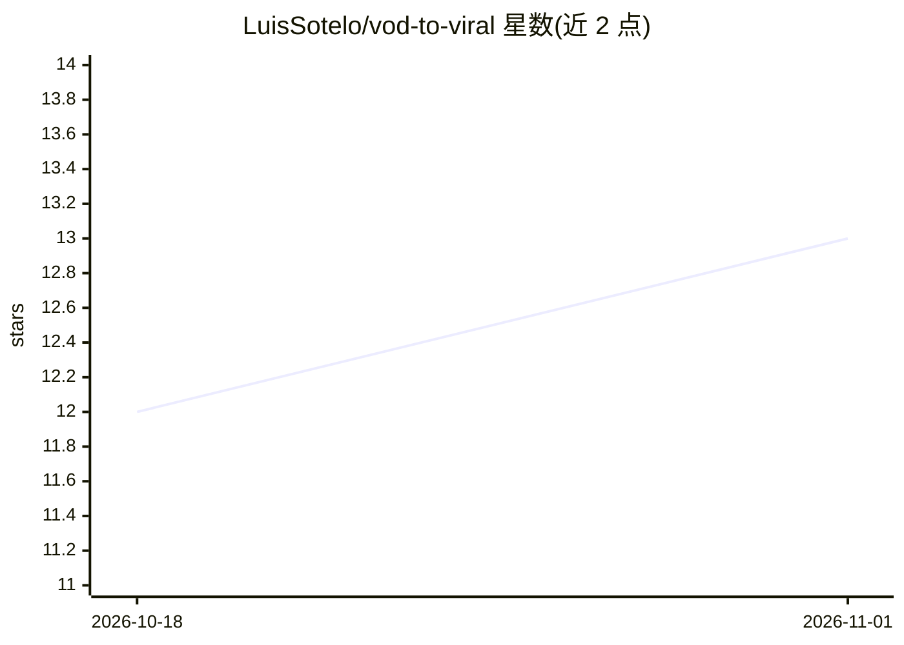

# LuisSotelo/vod-to-viral

⭐ 13 · Python · 推送 2026-06-15 · [GitHub](https://github.com/LuisSotelo/vod-to-viral) · 个人维护

**自动把 Twitch/YouTube 长视频切成带字幕的竖版病毒式短片**

Python 编写的自动剪辑流水线：监控 Twitch 频道，直播结束后仅下载音频与聊天 JSON，基于音量、聊天关键词与活跃度做信号评分选出高光片段，再通过 yt-dlp 精准下载 30-45 秒片段，用 ffmpeg 硬件加速（h264_nvenc，可回退 libx264）渲染竖版布局并注入逐词高亮字幕，faster-whisper 生成转录，Gemini API 生成标题与标签，并分发到 YouTube Shorts、TikTok、Instagram Reels。限制：twitch 布局模式要求摄像头位于画面左上角，CPU 转录速度慢，需配置 Twitch API 凭据与 FFmpeg、TwitchDownloaderCLI 等系统依赖。

## 筛选速览

| 维度 | 判定 | 备注 |
|---|---|---|
| AI 角色 | `ai-native` | 本体是模型或模型工具 |
| 许可风险 | `none` | — |
| 部署形态 | `None` |  |
| 模型依赖 | — | README 未给出锁定关系 |
| 硬件要求 | — | 无带数字的原话,不猜 |
| 安装摩擦 | `medium` | 含编译或系统依赖之一 |
| 成熟度 | — | 结构信号不足 |

## 能力要点

- 音量+聊天+文本多信号评分检测高光片段
- 仅下载音频与聊天 JSON，精准下载高光片段 mp4
- faster-whisper 逐词转录与 ASS 动态字幕
- Gemini 生成标题/标签并自动上传 Shorts、TikTok、Reels

## 适用场景

- 直播主下播后自动产出并发布竖版短视频
- 把 YouTube 长视频手动转成竖版短片
- 批量从 Twitch VOD 提取高光片段并配字幕

## 场景标签

`图像视频处理` `工作流自动化` · 领域:效率与自动化

## 证据(README 行号)

> L29:  - Analiza la fusión de señales de volumen (RMS), keywords y actividad del chat para calcular el *Signal Scoring Ma
> L39: - 🎧 **Transcripción nativa:** Procesamiento con `faster-whisper` (GPU CUDA opcional).

## 星数曲线

2026-10-18 12 → 2026-11-01 13（+1）

---
*卡片 v1 · prompt 1.4 · 生成 2026-10-31 · 置信度 high · 依据 README sha `6a3a68cdef2c` · [字段定义](../../DATASET.md)*
