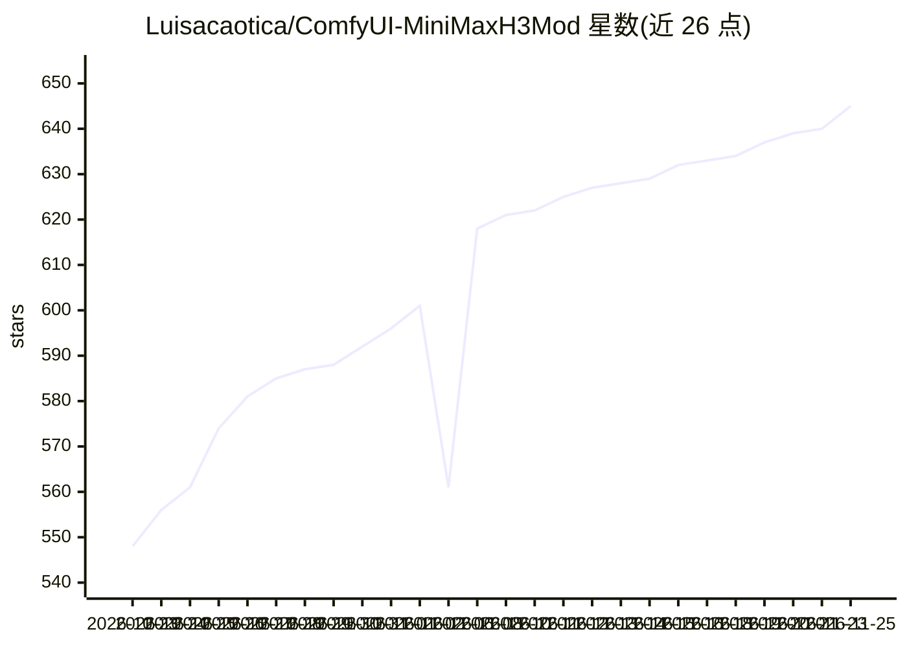

# Luisacaotica/ComfyUI-MiniMaxH3Mod

⭐ 645 · Python · MIT · 推送 2026-11-14 · [GitHub](https://github.com/Luisacaotica/ComfyUI-MiniMaxH3Mod) · 个人维护

**ComfyUI 节点包：为 MiniMax H3 提供免训练的参考图/视频/音频 RefMod**

该仓库是 ComfyUI 自定义节点集合，将 MiniMax H3 的图像、视频或音频参考压缩保存为可复用的 .safetensors 文件，再经 Apply H3 RefMod 节点注入生成流程。提取使用对应的 VAE，不训练 H3 权重，也不依赖扩散模型本体；视觉模式提供 encode（保留更多细节）与 training（仅优化小型潜变量）两种压缩路径，并注明无法保证属性迁移的精确性，音频部分明确声明说话人音色迁移在当前测试中失败。需运行在原生支持 MiniMax H3 的 ComfyUI 上，克隆到 custom_nodes 后重启即可。

## 筛选速览

| 维度 | 判定 | 备注 |
|---|---|---|
| AI 角色 | `ai-native` | 本体是模型或模型工具 |
| 许可风险 | `permissive` | MIT |
| 部署形态 | `library` | 以包/库形式分发 |
| 模型依赖 | — | README 未给出锁定关系 |
| 硬件要求 | — | 无带数字的原话,不猜 |
| 安装摩擦 | `medium` | 含编译或系统依赖之一 |
| 成熟度 | `idea` | |

## 能力要点

- 免训练参考适配器：以 VAE 提取方式压缩参考为 .safetensors 潜变量包
- 单文件捆绑视觉与音频参考，支持独立的视觉/音频强度控制与最多 8 个加载槽
- 库与检查器支持搜索/过滤收藏、token 成本检查与预览，兼容 extra_model_paths.yaml
- 自带示例 mod（mods/vanellope_example.safetensors）与加载器回归测试脚本

## 适用场景

- 在 ComfyUI 中复用已保存的角色/场景参考
- 压缩参考 token 预算以减少生成处理量
- 管理多参考库并按子文件夹加载

## 场景标签

`图像生成` `视频生成` · 领域:内容生成

## 证据(README 行号)

> L92: RefMod saves MiniMax H3 image, video or audio references as reusable
> L97: Extraction uses the corresponding VAE. It does not train H3 weights or require
> L116: 1. Use a current ComfyUI with native MiniMax H3 support. RefMod does not

## 星数曲线

2026-10-23 548 → 2026-11-25 645（+97）

---
*卡片 v1 · prompt 1.4 · 生成 2026-11-24 · 置信度 mid · 依据 README sha `dec5f6b22dc0` · [字段定义](../../DATASET.md)*
