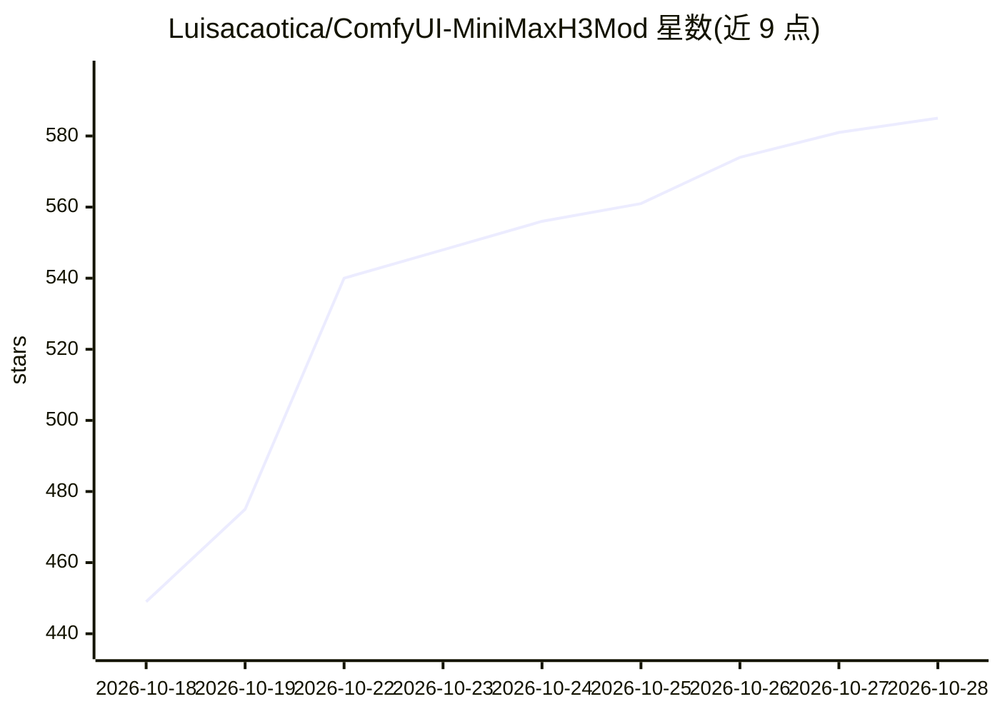

# Luisacaotica/ComfyUI-MiniMaxH3Mod

⭐ 587 · Python · MIT · 推送 2026-10-15 · [GitHub](https://github.com/Luisacaotica/ComfyUI-MiniMaxH3Mod) · 个人维护

**ComfyUI 自定义节点包：免训练压缩 MiniMax H3 图/视频/音频参考**

面向 ComfyUI 用户与 MiniMax H3 模型的自定义节点包：将图像、视频、音频参考素材经对应 VAE 编码为可复用的 .safetensors RefMod 文件，压缩参考 token 数量，供 Apply H3 RefMod 节点在生成时加载组合。无需训练 H3 权重、不依赖 diffusion 模型。提供 Master 一体化提取、库检索、掩码列表、bundle 保存与音频集成；声明的限制包括：API 与节点架构仍在变动、语音身份迁移在测试中失败、压缩会有信息损失。通过 clone 到 custom_nodes 安装。

## 筛选速览

| 维度 | 判定 | 备注 |
|---|---|---|
| AI 角色 | `ai-ecosystem` | LLM/agent 周边工具 |
| 许可风险 | `permissive` | MIT |
| 部署形态 | `library` | 以包/库形式分发 |
| 模型依赖 | — | README 未给出锁定关系 |
| 硬件要求 | — | 无带数字的原话,不猜 |
| 安装摩擦 | `medium` | 含编译或系统依赖之一 |
| 成熟度 | `idea` | |

## 能力要点

- 图/视频/音频参考压缩为可复用 .safetensors，无需训练 H3 权重
- encode（保留细节）与 training（池化+精炼，减少 token）两种视觉模式
- Master 单节点提取视觉与音频，bundle 单文件保存
- 库搜索、token 成本检查、子文件夹递归发现与 extra_model_paths.yaml 支持

## 适用场景

- 把角色/场景参考保存成可复用文件，反复用于 H3 生成
- 压缩参考 token 预算以控制生成时的注意力开销
- 在 ComfyUI 中组合多个视觉与音频参考进行生成

## 场景标签

`图像生成` `视频生成` · 领域:内容生成

## 证据(README 行号)

> L92: RefMod saves MiniMax H3 image, video or audio references as reusable
> L116: 1. Use a current ComfyUI with native MiniMax H3 support. RefMod does not
> L125: 2. **This pack**: clone into `custom_nodes/` and restart ComfyUI. Python

## 星数曲线

2026-10-18 449 → 2026-10-28 585（+136）

---
*卡片 v1 · prompt 1.4 · 生成 2026-10-21 · 置信度 mid · 依据 README sha `14e15478dcd7` · [字段定义](../../DATASET.md)*
