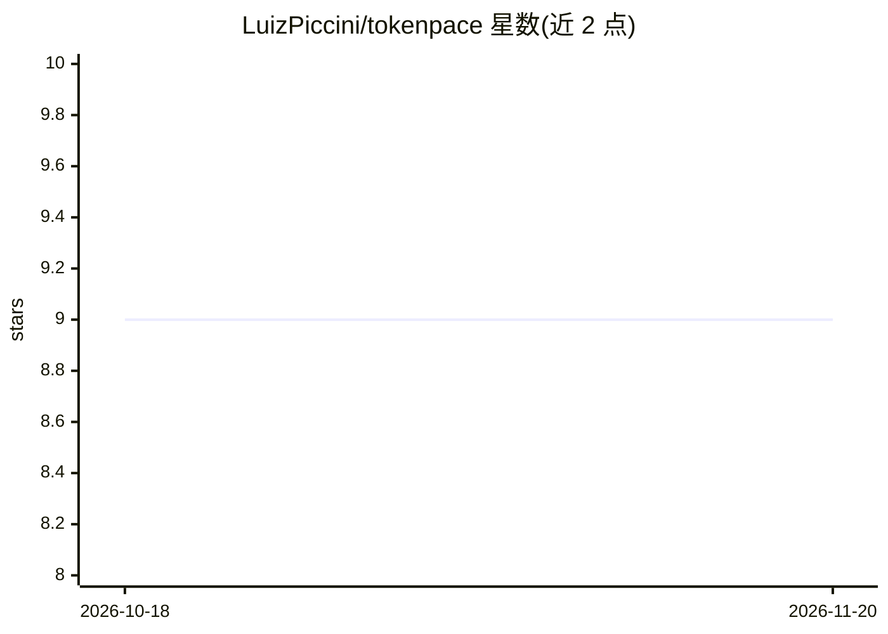

# LuizPiccini/tokenpace

⭐ 9 · Python · MIT · 推送 2026-11-19 · [GitHub](https://github.com/LuizPiccini/tokenpace) · 个人维护

**为多 AI 订阅用户排序配额使用进度，避免额度浪费**

自托管工具：读取 ChatGPT/Codex、Claude（经 Claude Code 登录凭证）、OpenRouter 免费层及手动输入的用量限制，按'剩余配额比例 ÷ 剩余时间比例'计算 needed pace 并给出 Use first/On pace/Save 等判定，输出网页仪表盘、JSON API、Android 桌面小组件，Windows/macOS 有浮动小窗，Linux 有面板托盘。仅依赖 Python 3.11+ 标准库；Claude 登录约 8 小时过期、由 Claude Code 运行时续期，读取的是官方应用使用的未公开用量端点。

## 筛选速览

| 维度 | 判定 | 备注 |
|---|---|---|
| AI 角色 | `ai-ecosystem` | LLM/agent 周边工具 |
| 许可风险 | `permissive` | MIT |
| 部署形态 | `None` |  |
| 模型依赖 | locked-api |  |
| 硬件要求 | — | 无带数字的原话,不猜 |
| 安装摩擦 | `medium` | 含编译或系统依赖之一 |
| 成熟度 | — | 结构信号不足 |

## 能力要点

- 按最长窗口计算 needed pace，输出 6 类使用判定与 3 天重置时间线
- 支持 codex/claude_code/openrouter_free/manual/push/demo 六种数据来源
- 同一排名可呈现为网页、JSON API、Android 小组件与桌面浮动窗/托盘
- 服务端仅用 Python 标准库，无第三方依赖

## 适用场景

- 同时持有多个 AI 订阅时决定先用哪个额度
- 在 Android 主屏或桌面常驻查看各订阅配额进度
- 跨多台机器汇总各设备的订阅用量数据

## 场景标签

 · 领域:开发者工具/用量监控

## 证据(README 行号)

> L3: **Which AI subscription should you use first?** Token Pace reads the usage limits of
> L66: ## Providers

## 星数曲线

2026-10-18 9 → 2026-11-20 9（+0）

---
*卡片 v1 · prompt 1.4 · 生成 2026-11-20 · 置信度 mid · 依据 README sha `f50fb84bab22` · [字段定义](../../DATASET.md)*
