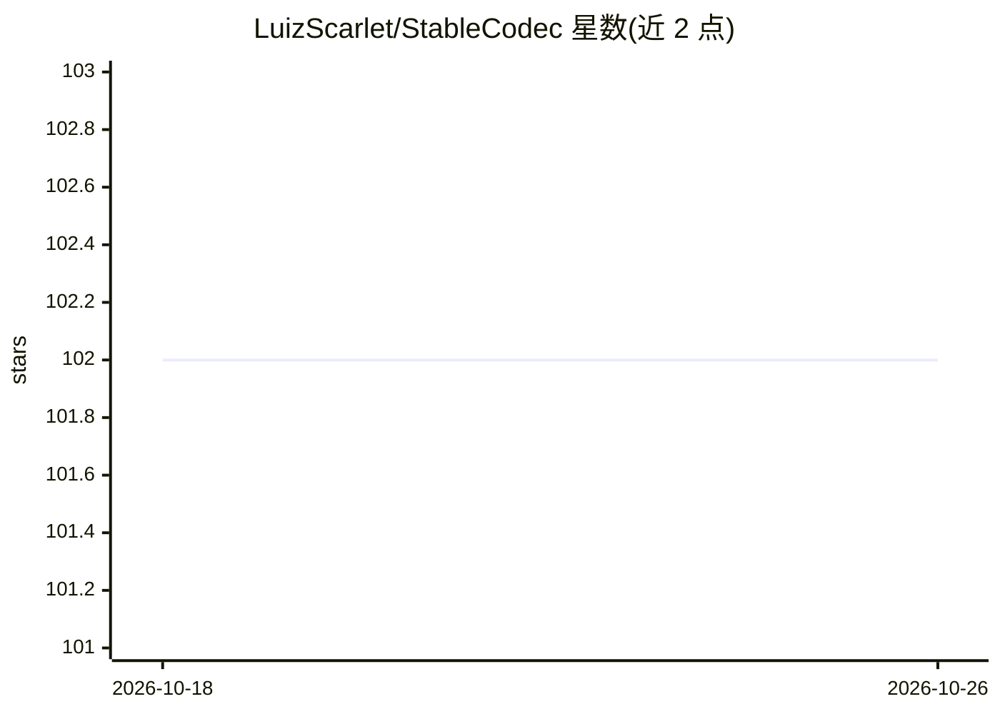

# LuizScarlet/StableCodec

⭐ 102 · Python · MIT · 推送 2026-07-03 · [GitHub](https://github.com/LuizScarlet/StableCodec) · [官网](https://arxiv.org/abs/2506.21977) · 组织维护 · 中文 README

**面向科研者的单步扩散极低码率图像压缩模型（ICCV 2025）**

中国科学技术大学团队发表的 ICCV 2025 论文官方代码，实现基于单步扩散的极低码率（低至 0.005bpp）高保真高真实感图像压缩。机制上使用深度压缩隐空间编解码器传输噪声隐表示，双分支编解码结构增强重建保真度，端到端联合码率与像素级约束优化。提供 conda/pip 安装、预训练权重、推理/评测/两阶段训练脚本；训练在 2×RTX 3090 (24G) 上进行，依赖 SD-Turbo 与 ELIC 预训练模型。MIT 许可。

## 筛选速览

| 维度 | 判定 | 备注 |
|---|---|---|
| AI 角色 | `ai-native` | 本体是模型或模型工具 |
| 许可风险 | `permissive` | MIT |
| 部署形态 | `library` | 以包/库形式分发 |
| 模型依赖 | — | README 未给出锁定关系 |
| 硬件要求 | — | 无带数字的原话,不猜 |
| 安装摩擦 | `low` | 无编译、无系统依赖或容器化 |
| 成熟度 | — | 结构信号不足 |

## 能力要点

- 单步扩散实现 0.005bpp 级极低码率图像压缩
- Deep Compression Latent Codec + 双分支编解码结构
- 提供预训练权重与两阶段训练流程（含 GAN 微调）
- 在 Kodak/DIV2K/CLIC2020 等基准上提供推理与评测脚本

## 适用场景

- 在极低码率下压缩高分辨率图像并保留真实感
- 复现论文的率-失真-感知实验结果
- 基于公开代码与权重微调自己的压缩模型

## 场景标签

`图像视频处理` · 领域:感知与多模态

## 证据(README 行号)

> L27: Diffusion-based image compression has shown remarkable potential for achieving ultra-low bitrate coding (less than 
> L160: This work is licensed under MIT license.

## 星数曲线

2026-10-18 102 → 2026-10-26 102（+0）

---
*卡片 v1 · prompt 1.4 · 生成 2026-10-23 · 置信度 mid · 依据 README sha `d6b02ebf8182` · [字段定义](../../DATASET.md)*
