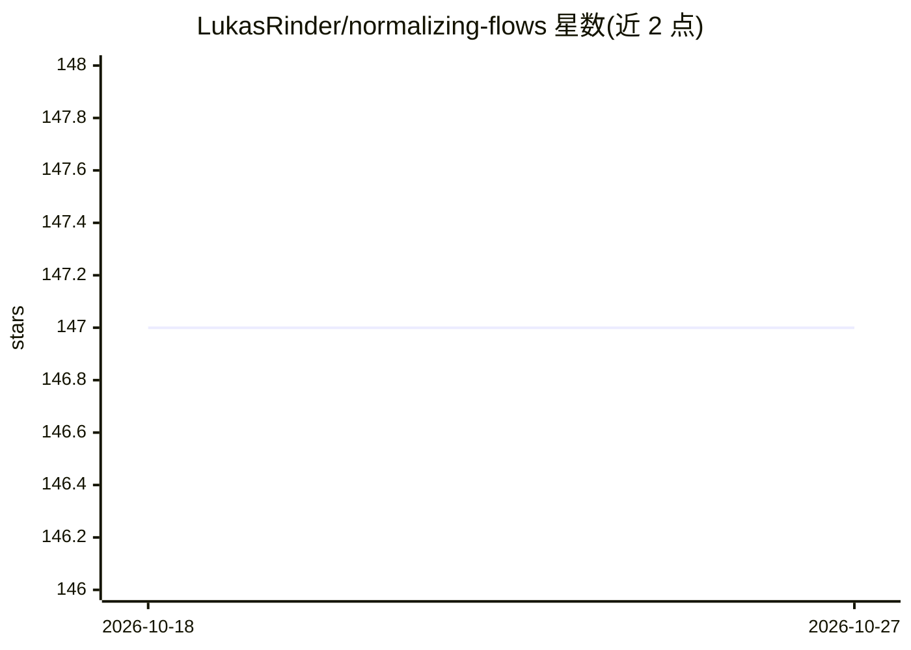

# LukasRinder/normalizing-flows

⭐ 147 · Jupyter Notebook · GPL-3.0 · 推送 2026-10-08 · [GitHub](https://github.com/LukasRinder/normalizing-flows) · 组织维护

**TensorFlow 2 的 normalizing flows 实现库，含密度估计教程**

在 TensorFlow 2.0 中实现多种 normalizing flows（Planar、Radial、Real NVP、MAF、IAF、Neural Spline Flow），代码集中于 normalizingflows/flow_catalog.py，部分组件复用 TensorFlow Probability 的 bijector 实现。支持在 2D toy 数据、UCI 数据集（GAS/POWER/MINIBOONE）、MNIST 与 CelebA 上做密度估计，具代数逆的 flow 可用作生成模型。提供 example_training.ipynb 教程与实验结果示例。该工作产生于 TUM 的大规模机器学习实践课程，未在 README 中给出安装命令。

## 筛选速览

| 维度 | 判定 | 备注 |
|---|---|---|
| AI 角色 | `ai-native` | 本体是模型或模型工具 |
| 许可风险 | `viral` | GPL-3.0 |
| 部署形态 | `None` |  |
| 模型依赖 | — | README 未给出锁定关系 |
| 硬件要求 | — | 无带数字的原话,不猜 |
| 安装摩擦 | `low` | 无编译、无系统依赖或容器化 |
| 成熟度 | — | 结构信号不足 |

## 能力要点

- 实现 6 种 normalizing flows（Planar/Radial/Real NVP/MAF/IAF/Neural Spline Flow）
- 提供 toy 数据、UCI、MNIST、CelebA 的数据加载函数
- example_training.ipynb 密度估计教程
- 含实验文件夹与 MNIST/CelebA 生成图像示例

## 适用场景

- 学习与实验 normalizing flows 密度估计方法
- 在 toy 或真实数据集上训练基于 flow 的生成模型
- 课程或研究中对比多种 flow 结构的效果

## 场景标签

`教程课程` · 领域:学习与行业

## 证据(README 行号)

> L3: In this project, we implemented various normalizing flows in Tensorflow 2.0 and tested them on different datasets.
> L19: The normalizing flows can be tested in terms of estimating the density on various datasets.
> L20: If an algebraic inverse is available, the flows can also be used as flow-based generative model.

## 星数曲线

2026-10-18 147 → 2026-10-27 147（+0）

---
*卡片 v1 · prompt 1.4 · 生成 2026-10-22 · 置信度 high · 依据 README sha `aa533d149981` · [字段定义](../../DATASET.md)*
