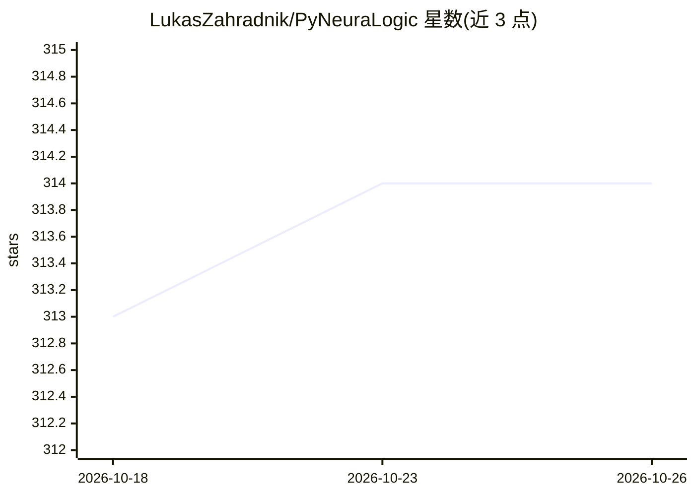

# LukasZahradnik/PyNeuraLogic

⭐ 314 · Python · MIT · 推送 2026-10-22 · [GitHub](https://github.com/LukasZahradnik/PyNeuraLogic) · [官网](https://pyneuralogic.readthedocs.io/) · 个人维护

**Python 可微逻辑编程框架，用逻辑规则构建深度学习模型**

PyNeuraLogic 是一个基于 Python 的可微逻辑编程框架，通过 NeuraLogic 后端将逻辑程序推理过程变为可微分计算，使逻辑规则关联的数值参数可以像神经网络权重一样学习。用户以声明式逻辑规则定义 GNN 传播层（如 GCN）及超越图结构的关系模型（超图、关系数据库、子图模式等），后端自动动态生成可微分计算图。提供预定义模块（GCNConv、Transformer、LSTM 等）与 Colab 示例。要求 Python>=3.10 与 Java>=1.8，可视化需另装 Graphviz。

## 筛选速览

| 维度 | 判定 | 备注 |
|---|---|---|
| AI 角色 | `ai-ecosystem` | LLM/agent 周边工具 |
| 许可风险 | `permissive` | MIT |
| 部署形态 | `library` | 以包/库形式分发 |
| 模型依赖 | — | README 未给出锁定关系 |
| 硬件要求 | — | 无带数字的原话,不猜 |
| 安装摩擦 | `low` | 无编译、无系统依赖或容器化 |
| 成熟度 | — | 结构信号不足 |

## 能力要点

- 以逻辑规则声明式定义可学习模型（规则即代码）
- 表达范围覆盖 GNN 及超图/关系数据库/子图模式等关系学习
- 后端自动动态生成可微分计算图，无需手工对齐静态张量操作
- 内置 GCNConv、SAGEConv、Transformer、LSTM 等预定义模块

## 适用场景

- 用逻辑规则快速搭建与变体化 GNN 模型
- 在关系数据库/超图等图之外的结构上做深度关系学习
- 复现论文中的 lifted relational neural network 方法

## 场景标签

 · 领域:机器学习框架/图神经网络

## 证据(README 行号)

> L12: PyNeuraLogic lets you use Python to write **Differentiable Logic Programs**
> L18: PyNeuralogic, through its **NeuraLogic** backend, then makes this inference process _differentiable_ which, in turn
> L69: The backend engine then creates the underlying differentiable computation (inference) graphs in a fully automated a

## 星数曲线

2026-10-18 313 → 2026-10-26 314（+1）

---
*卡片 v1 · prompt 1.4 · 生成 2026-10-21 · 置信度 high · 依据 README sha `934e0177b33d` · [字段定义](../../DATASET.md)*
