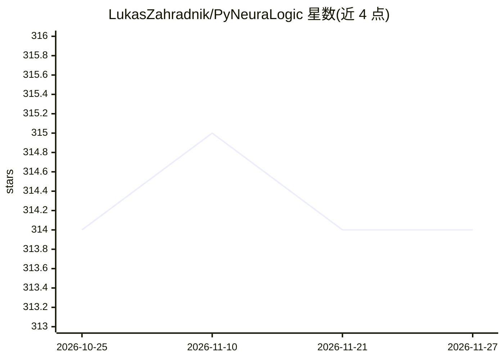

# LukasZahradnik/PyNeuraLogic

⭐ 314 · Python · MIT · 推送 2026-10-22 · [GitHub](https://github.com/LukasZahradnik/PyNeuraLogic) · [官网](https://pyneuralogic.readthedocs.io/) · 个人维护

**用 Python 编写可微分逻辑程序的关系学习框架**

基于 NeuraLogic 后端的 Python 框架，将逻辑规则的推理过程变为可微分计算，等价于深度学习的前向传播，从而可像神经网络权重一样学习规则参数。图神经网络是其特例（二元关系），用户以逻辑规则直接声明模型，支持多关系与对象类型、超图、嵌套图、子图 GNN、背景知识注入等，后端自动动态构建可微分计算图。预置 GCN/SAGE/GIN 等模块，提供多个 Colab 示例与论文链接。

## 筛选速览

| 维度 | 判定 | 备注 |
|---|---|---|
| AI 角色 | `ai-native` | 本体是模型或模型工具 |
| 许可风险 | `permissive` | MIT |
| 部署形态 | `library` | 以包/库形式分发 |
| 模型依赖 | — | README 未给出锁定关系 |
| 硬件要求 | — | 无带数字的原话,不猜 |
| 安装摩擦 | `low` | 无编译、无系统依赖或容器化 |
| 成熟度 | — | 结构信号不足 |

## 能力要点

- 以逻辑规则声明可学习模型，后端自动生成可微分计算图
- 支持超图、嵌套图、关系数据库、子图 GNN 等关系结构
- 预定义 GNN/Transformer/LSTM 等模块，含 PyTorch 集成
- 提供多个 Colab 示例（分子 GNN、子图模式等）

## 适用场景

- 编写超出常规图结构的深层关系学习模型
- 学习分子等关系数据的 GNN 模型
- 将逻辑背景知识融入可学习模型
- 以声明式规则替代层层嵌套的 GNN 类定义

## 场景标签

`模型训练` · 领域:训练与推理

## 证据(README 行号)

> L12: PyNeuraLogic lets you use Python to write **Differentiable Logic Programs**
> L18: PyNeuralogic, through its **NeuraLogic** backend, then makes this inference process _differentiable_ which, in turn

## 星数曲线

2026-10-25 314 → 2026-11-27 314（+0）

---
*卡片 v1 · prompt 1.4 · 生成 2026-11-25 · 置信度 high · 依据 README sha `a6c8b596f656` · [字段定义](../../DATASET.md)*
