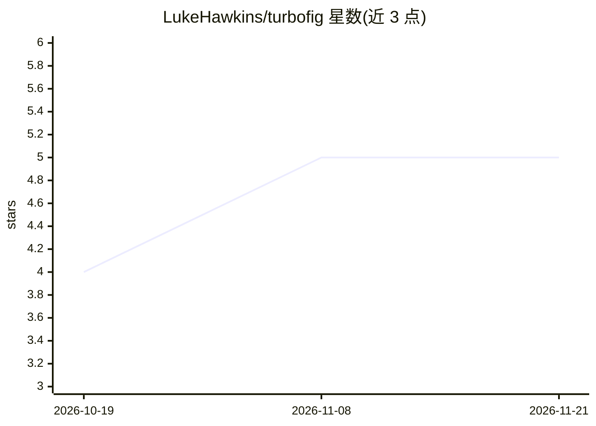

# LukeHawkins/turbofig

⭐ 5 · Rust · MIT · 推送 2026-10-08 · [GitHub](https://github.com/LukeHawkins/turbofig) · 个人维护

**让 AI agent 通过文件桥接控制 Figma 的 macOS 工具**

一个运行于 macOS 的 Figma 桥接应用：AI agent（Claude Code、Cursor、Codex、Copilot 等）通过写入文件驱动 Figma Desktop 执行插件可运行的任意脚本，操作图层、组件、变量与样式；也提供 MCP 模式作为可选连接方式。通过 Homebrew 安装，配合导入 Figma 插件使用，无需 Figma token 或付费席位。仅支持 macOS 与 Figma Desktop，浏览器端聊天应用无法使用。

## 筛选速览

| 维度 | 判定 | 备注 |
|---|---|---|
| AI 角色 | `ai-ecosystem` | LLM/agent 周边工具 |
| 许可风险 | `permissive` | MIT |
| 部署形态 | `None` |  |
| 模型依赖 | — | README 未给出锁定关系 |
| 硬件要求 | — | 无带数字的原话,不猜 |
| 安装摩擦 | `low` | 无编译、无系统依赖或容器化 |
| 成熟度 | — | 结构信号不足 |

## 能力要点

- 通过文件桥接连接 agent，无需 MCP 服务器（另提供 MCP 模式）
- 可运行任意 Figma 插件脚本：frames、components、variants、variables、styles
- 截图保存为文件并缩至 1200px，降低上下文占用
- 支持多文件与多个 agent 会话并行，断线自动重连

## 适用场景

- 用自然语言让 agent 搭建 Figma 页面框架与组件
- 批量重命名、改样式或生成暗色模式变体
- 从 CSV/JSON 列表批量生成 frame 网格
- 让 agent 对齐代码组件与 Figma 设计的间距和颜色

## 场景标签

`GUI 自动化` · 领域:效率与自动化

## 证据(README 行号)

> L11: turbofig is a free, open-source **Figma bridge for AI agents** on macOS.
> L13: MCP mode is there if you prefer). Ask Claude Code, Cursor, Codex or
> L121: Code: `claude mcp add turbofig -- turbofig mcp`. See

## 星数曲线

2026-10-19 4 → 2026-11-21 5（+1）

---
*卡片 v1 · prompt 1.4 · 生成 2026-11-21 · 置信度 high · 依据 README sha `72222605fd79` · [字段定义](../../DATASET.md)*
