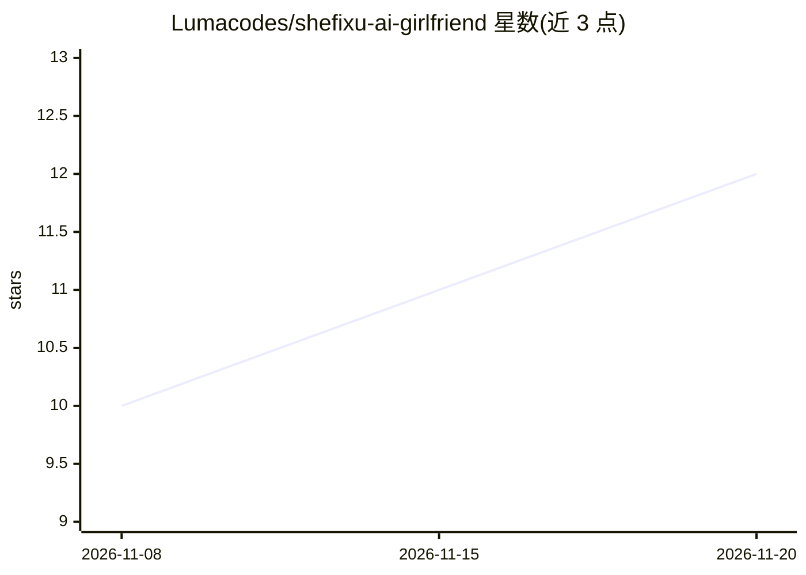

# Lumacodes/shefixu-ai-girlfriend

⭐ 12 · TypeScript · 推送 2026-07-19 · [GitHub](https://github.com/Lumacodes/shefixu-ai-girlfriend) · 个人维护

**浏览器中运行的本地 3D AI 虚拟伴侣，语音对话带口型同步**

基于 React Three Fiber 与 VRM 模型的 3D 虚拟伴侣应用：Web Speech API 采集语音输入，经 OpenRouter 接入的 LLM 生成回复，edge-tts/FastAPI 本地运行 Microsoft Neural TTS 合成语音，Web Audio 频率数据逐帧驱动 VRM morph target 实现口型同步，动画全部为程序化生成。通过修改单一文件可更换模型、语音与性格。需 Node 18+ 与 Python 3.11+，TTS 服务器须本地运行，暂无跨会话记忆，VRM 1.0 未测试。

## 筛选速览

| 维度 | 判定 | 备注 |
|---|---|---|
| AI 角色 | `ai-native` | 本体是模型或模型工具 |
| 许可风险 | `permissive` | — |
| 部署形态 | `library` | 以包/库形式分发 |
| 模型依赖 | locked-api |  |
| 硬件要求 | — | 无带数字的原话,不猜 |
| 安装摩擦 | `low` | 无编译、无系统依赖或容器化 |
| 成熟度 | — | 结构信号不足 |

## 能力要点

- Web Audio FFT → VRM morph target 的实时口型同步管线
- edge-tts 本地运行 Microsoft Neural TTS，300+ 语音可选
- OpenRouter 一行切换 LLM 模型（DeepSeek/Gemini/Claude/GPT-4o）
- 程序化 idle 动画，无动画剪辑文件

## 适用场景

- 在浏览器里与 3D 语音角色实时对话
- 替换 VRM 模型与系统提示词自定义角色性格
- 练习外语对话的角色扮演伙伴

## 场景标签

`聊天机器人` `语音合成` `语音 Agent` · 领域:对话与助手

## 证据(README 行号)

> L26: - 🗣️ **Speaks back to you** — in a real Microsoft neural voice, generated offline, on your GPU
> L64: |LLM brain|OpenRouter — swap any model in 1 line|
> L67: |Lip-sync|Web Audio API frequency → VRM morph targets, every frame|

## 星数曲线

2026-11-08 10 → 2026-11-20 12（+2）

---
*卡片 v1 · prompt 1.4 · 生成 2026-11-19 · 置信度 high · 依据 README sha `4a8b988792a6` · [字段定义](../../DATASET.md)*
