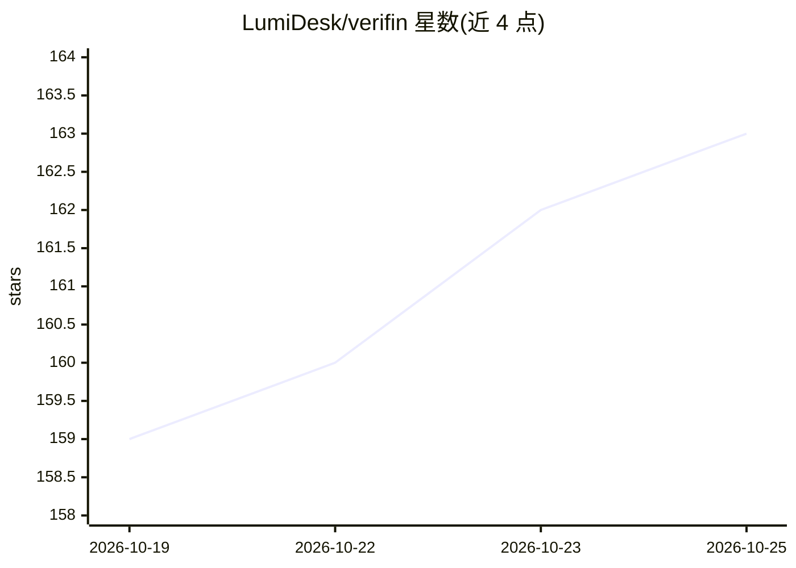

# LumiDesk/verifin

⭐ 167 · Dart · GPL-3.0 · 推送 2026-10-21 · [GitHub](https://github.com/LumiDesk/verifin) · [官网](https://verifin.talyra42.top) · 个人维护 · 中文 README

**本地优先、无账号的 Android 个人记账应用**

仅面向 Android 的个人记账应用，基于 Flutter/Dart 与 SQLite 构建。账本数据保存在设备本地，无账号、无服务端、无广告与遥测；支持多账本、多币种、离线汇率、预算与看板分析、图片附件与周期记账，提供加密备份（AES-GCM+PBKDF2）、WebDAV 备份与 CSV 导出。AI 为可选功能：用户配置 OpenAI 兼容端点后可记账、查询账目或识别截图，AI 只生成草稿不静默写入；另含端上 ML Kit OCR。从官网或 GitHub Releases 下载 APK 安装。

## 筛选速览

| 维度 | 判定 | 备注 |
|---|---|---|
| AI 角色 | `ai-enhanced` | 去掉 AI 部分产品仍成立 |
| 许可风险 | `viral` | GPL-3.0 |
| 部署形态 | `None` |  |
| 模型依赖 | — | README 未给出锁定关系 |
| 硬件要求 | — | 无带数字的原话,不猜 |
| 安装摩擦 | `medium` | 含编译或系统依赖之一 |
| 成熟度 | — | 结构信号不足 |

## 能力要点

- 本地优先存储，无账号/无服务端/无遥测
- 多账本、多币种、离线汇率、预算与多维看板
- 可选 AI：OpenAI 兼容端点记账/查询/截图识别，仅生成草稿
- AES-GCM+PBKDF2 加密备份与 WebDAV

## 适用场景

- 在 Android 设备上离线记录日常收支与转账
- 不依赖云服务管理个人账本并做多币种资产分析
- 用自选 AI 端点识别截图生成记账草稿

## 场景标签

 · 领域:个人财务/移动应用

## 证据(README 行号)

> L24: 可选 AI
> L43: - **可选 AI**：用自己的 OpenAI 兼容端点记账、查询账目或识别截图；AI 只生成草稿，不会静默写入。

## 星数曲线

2026-10-19 159 → 2026-10-25 163（+4）

---
*卡片 v1 · prompt 1.4 · 生成 2026-10-22 · 置信度 high · 依据 README sha `43df1359a9a8` · [字段定义](../../DATASET.md)*
