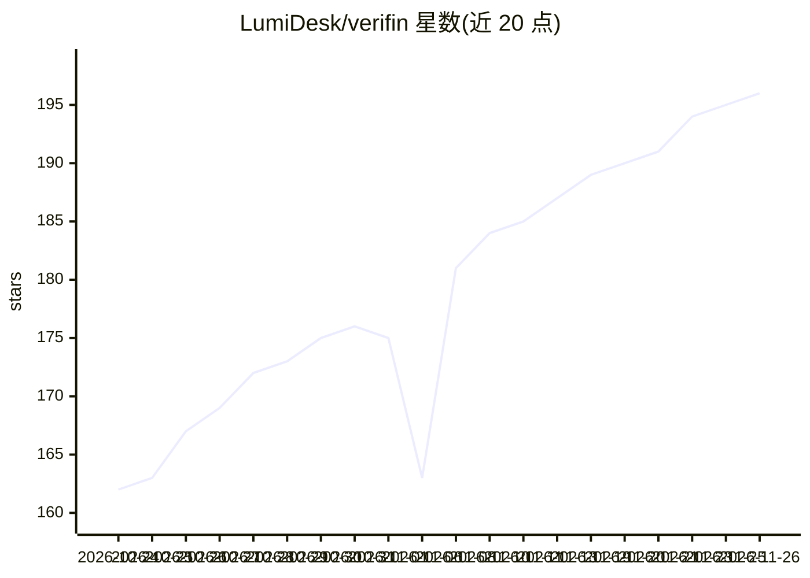

# LumiDesk/verifin

⭐ 196 · Dart · GPL-3.0 · 推送 2026-11-20 · [GitHub](https://github.com/LumiDesk/verifin) · [官网](https://verifin.talyra42.top) · 组织维护 · 中文 README

**本地优先的 Android 个人记账应用，可选 AI 辅助记账**

Veri Fin 是一款仅面向 Android 的个人记账应用，账本数据保存在本地设备，无账号、无服务端、无广告与行为遥测。核心功能覆盖支出/收入/转账记账、多账本与多币种资产、预算与多维看板分析、加密备份与 WebDAV、CSV 导入导出、桌面小组件等 Android 原生集成。AI 为可选功能：用户配置自己的 OpenAI 兼容端点后，可用于记账草稿、查询账目和截图识别（端上 ML Kit OCR），AI 只生成草稿、不静默写入。基于 Flutter 开发，从官网或 GitHub Releases 下载 APK 安装，正式包由 CI 构建。

## 筛选速览

| 维度 | 判定 | 备注 |
|---|---|---|
| AI 角色 | `ai-enhanced` | 去掉 AI 部分产品仍成立 |
| 许可风险 | `viral` | GPL-3.0 |
| 部署形态 | `None` |  |
| 模型依赖 | — | README 未给出锁定关系 |
| 硬件要求 | — | 无带数字的原话,不猜 |
| 安装摩擦 | `medium` | 含编译或系统依赖之一 |
| 成熟度 | — | 结构信号不足 |

## 能力要点

- 本地优先：无账号、无广告遥测，账本保存在设备上
- 可选 AI：用户自备 OpenAI 兼容端点，用于记账草稿与截图识别
- 多账本、多币种、离线汇率与预算看板分析
- AES-GCM 加密备份、WebDAV、CSV 导入导出

## 适用场景

- 在 Android 手机上离线记录个人收支与预算
- 用自己的 AI 端点识别账单截图生成记账草稿
- 通过 WebDAV 加密备份账本并跨设备迁移数据

## 场景标签

`OCR` · 领域:感知与多模态

## 证据(README 行号)

> L31: Veri Fin 是一款仅面向 Android 的个人记账应用。没有账号、没有自有服务端、没有广告，也不接入行为遥测。账本保存在你的设备上；只有你主动使用导出、WebDAV 备份或 AI 功能时，相关数据才会发送到你选择的目标。
> L44: - **可选 AI**：用自己的 OpenAI 兼容端点记账、查询账目或识别截图；AI 只生成草稿，不会静默写入。
> L54: |客户端|Flutter 3.47.2、Dart 3，仅发布 Android|

## 星数曲线

2026-10-24 162 → 2026-11-26 196（+34）

---
*卡片 v1 · prompt 1.4 · 生成 2026-11-25 · 置信度 high · 依据 README sha `7b8ea089a763` · [字段定义](../../DATASET.md)*
