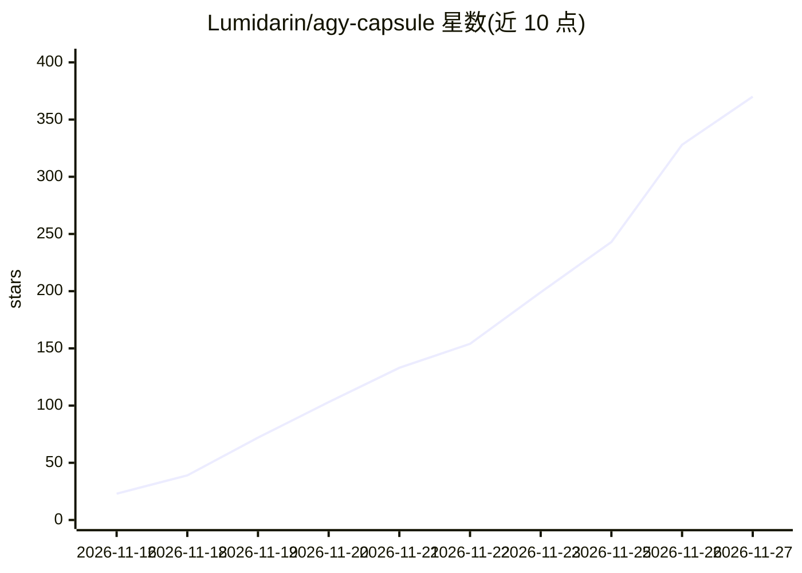

# Lumidarin/agy-capsule

⭐ 370 · JavaScript · MIT · 推送 2026-11-25 · [GitHub](https://github.com/Lumidarin/agy-capsule) · 个人维护 · 中文 README

**Antigravity 编辑器的上下文/配额/用量监控插件**

以胶囊形式嵌入 Antigravity 对话底栏的插件：实时显示上下文占用与缓存命中率、多模型额度池剩余与重置倒计时、生成速度、请求失败与首字等待提醒；上下文拆分为首轮/读取/思考/写入明细，侧栏提供日/周/月 Token 用量活动图与按模型系列堆叠统计。数据直接读取本机对话数据库，仅驻内存不上传。通过 CDP 接入宿主，提供 Windows/macOS/Linux 安装指南。

## 筛选速览

| 维度 | 判定 | 备注 |
|---|---|---|
| AI 角色 | `ai-ecosystem` | LLM/agent 周边工具 |
| 许可风险 | `permissive` | MIT |
| 部署形态 | `None` |  |
| 模型依赖 | — | README 未给出锁定关系 |
| 硬件要求 | — | 无带数字的原话,不猜 |
| 安装摩擦 | `low` | 无编译、无系统依赖或容器化 |
| 成熟度 | — | 结构信号不足 |

## 能力要点

- 底栏胶囊显示上下文占用、缓存命中率、5 小时/每周额度池与重置倒计时
- 上下文拆分为首轮/读取/思考/写入四项明细与过载变色提醒
- Token 用量活动图与按模型系列堆叠统计，读取本机对话数据库、结果不上传
- 支持中/英/繁体界面语言与高度自定义外观

## 适用场景

- 长对话中监控上下文占用避免过载
- 跟踪 Antigravity 多模型额度池的剩余与重置时间
- 按模型系列统计每日/每周 Token 用量

## 场景标签

`LLM 可观测性` · 领域:评测与运维

## 证据(README 行号)

> L5: 在 Antigravity 输入框底栏显示上下文占用、多模型配额、缓存状态和生成速度，悬停胶囊即可查看面板详情，点击胶囊即可固定面板。
> L45: 显示当前或所有额度池的 5 小时与每周剩余额度和重置倒计时。
> L162: - **用量统计**：把当前产品目录的本机对话数据库里每次模型请求记录的非缓存输入、缓存读取、缓存写入和输出相加。合计包含缓存读取（长对话中占比通常很高，与额度消耗无直接换算），不等于账单；仅统计当前产品目录且不含已删除的对话（

## 星数曲线

2026-11-16 23 → 2026-11-27 370（+347）

---
*卡片 v1 · prompt 1.4 · 生成 2026-11-25 · 置信度 high · 依据 README sha `8b82b03431a9` · [字段定义](../../DATASET.md)*
