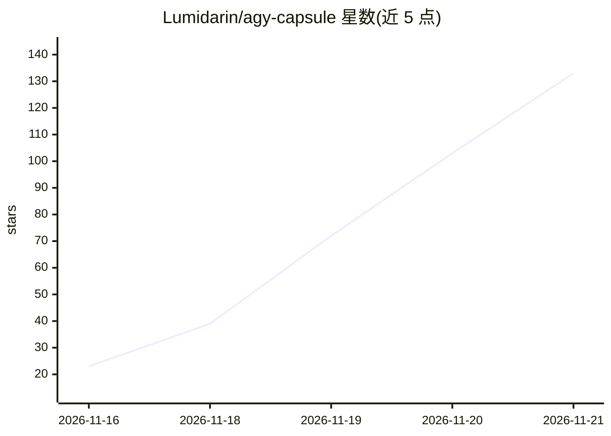

# Lumidarin/agy-capsule

⭐ 133 · JavaScript · MIT · 推送 2026-11-20 · [GitHub](https://github.com/Lumidarin/agy-capsule) · 个人维护 · 中文 README

**Antigravity 插件：在输入框底栏显示上下文占用与模型配额**

面向 Antigravity 用户的插件：在输入框底栏以胶囊形式显示上下文占用、缓存命中与过期状态、生成速度（按 TTFT+流式耗时计算总输出速度）、最近请求耗时、本轮统计，以及多额度池的 5 小时/每周剩余额度与重置倒计时；请求失败时弹出胶囊并分类展示报错原因（额度耗尽、429 限流、断连等）。上限按当前会话和模型实时读取，设置存储于 ~/.gemini/config 下，安装/更新/卸载通过各平台脚本完成，更新后自动重启重连侧栏。

## 筛选速览

| 维度 | 判定 | 备注 |
|---|---|---|
| AI 角色 | `ai-ecosystem` | LLM/agent 周边工具 |
| 许可风险 | `permissive` | MIT |
| 部署形态 | `None` |  |
| 模型依赖 | — | README 未给出锁定关系 |
| 硬件要求 | — | 无带数字的原话,不猜 |
| 安装摩擦 | `low` | 无编译、无系统依赖或容器化 |
| 成熟度 | — | 结构信号不足 |

## 能力要点

- 上下文占用拆分为首轮/读取/思考/写入四部分并显示占比
- 多额度池 5 小时与每周剩余额度、重置倒计时；Vertex AI 按量计费时隐藏额度胶囊
- 请求失败胶囊分类提示额度耗尽、限流 429、断连等 7 类原因
- 设置语言与显示语言分离，支持 English/简体中文/繁體中文

## 适用场景

- 写代码时随时查看上下文窗口还剩多少
- 盯额度池剩余量和重置倒计时，避免额度耗尽中断
- 请求失败时快速定位是限流还是断连

## 场景标签

`LLM 可观测性` · 领域:评测与运维

## 证据(README 行号)

> L5: 在 Antigravity 输入框底栏显示上下文占用、多模型配额、缓存状态和生成速度，悬停胶囊即可查看面板详情，点击胶囊即可固定面板。
> L28: 显示当前或所有额度池的 5 小时与每周剩余额度和重置倒计时。

## 星数曲线

2026-11-16 23 → 2026-11-21 133（+110）

---
*卡片 v1 · prompt 1.4 · 生成 2026-11-18 · 置信度 high · 依据 README sha `471fd41155a8` · [字段定义](../../DATASET.md)*
