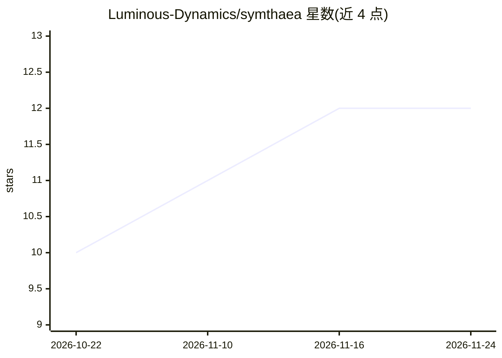

# Luminous-Dynamics/symthaea

⭐ 12 · Rust · AGPL-3.0 · 推送 2026-11-22 · [GitHub](https://github.com/Luminous-Dynamics/symthaea) · [官网](https://symthaea.luminousdynamics.io) · 个人维护

**意识优先认知架构研究项目：HDC+CfC+IIT+FEP 配 ZKP 证明栈**

以 Rust 编写的实验性认知架构研究代码库，组合超维计算（16,384D HDC）、液态时间常数网络（CfC）、IIT 启发的 Φ 度量与 Butlin 指标探针，并配套零知识证明栈（Binius 二域 STARK、Dilithium5），覆盖健康值范围证明、选择性凭证披露、可验证联邦学习等电路。面向研究者与开发者提供 87 个 crate、可复现基准脚本与论文草稿。README 明确声明不证明意识、不构成合规认证，并保留已撤回数据的记录。

## 筛选速览

| 维度 | 判定 | 备注 |
|---|---|---|
| AI 角色 | `ai-native` | 本体是模型或模型工具 |
| 许可风险 | `viral` | AGPL-3.0 |
| 部署形态 | `None` |  |
| 模型依赖 | — | README 未给出锁定关系 |
| 硬件要求 | — | 无带数字的原话,不猜 |
| 安装摩擦 | `low` | 无编译、无系统依赖或容器化 |
| 成熟度 | `idea` | |

## 能力要点

- HDC XOR 绑定在二域 STARK 下约束数为基线的 1/256（README 内部复现数据）
- ZK 电路库覆盖范围证明、联邦学习聚合、状态转移证明等场景
- 4 阶段认知循环（感知→演化→度量→行动）与浏览器 WASM 内核（324 KB）
- 自带证据表记录被撤回的早期基准数据

## 适用场景

- 研究超维计算与零知识证明的结合实现
- 复现二域 STARK 与 prime-field 基线的对比基准
- 探索认知架构的意识相关计算指标与探针

## 场景标签

`科研工具` · 领域:学习与行业

## 证据(README 行号)

> L3: **Experimental cognitive architecture for testing verifiable state transitions, representation mechanisms, and consc
> L85: |`symthaea`|Main cognitive loop (4-phase: perceive → evolve → measure → act)|7K+|
> L103: |**Binary-Field STARKs for HDC**|IEEE S&P 2027|Submission-ready (v5)|

## 星数曲线

2026-10-22 10 → 2026-11-24 12（+2）

---
*卡片 v1 · prompt 1.4 · 生成 2026-11-18 · 置信度 mid · 依据 README sha `3965949f639d` · [字段定义](../../DATASET.md)*
