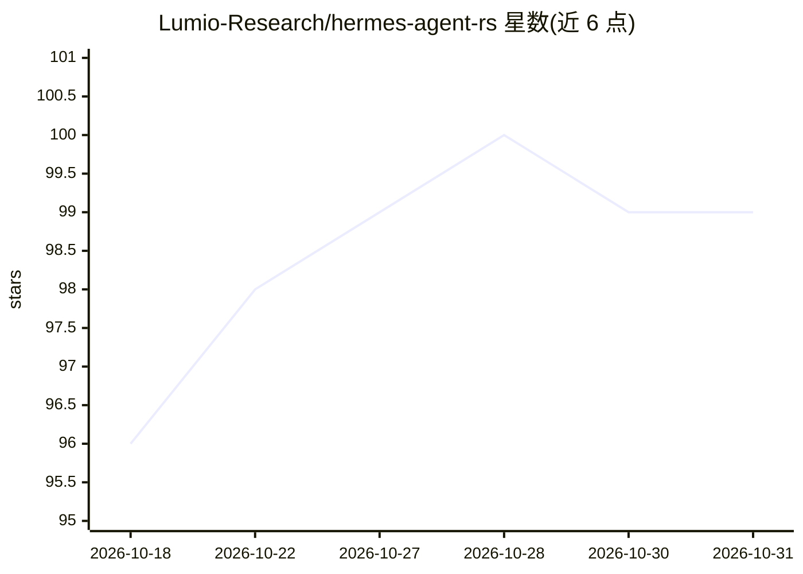

# Lumio-Research/hermes-agent-rs

⭐ 99 · Rust · MIT · 推送 2026-07-08 · [GitHub](https://github.com/Lumio-Research/hermes-agent-rs) · [官网](https://github.com/Lumio-Research/hermes-agent-rust#readme) · 组织维护 · 中文 README

**Rust 单二进制自进化 AI agent，接 10 家 LLM、30+ 工具**

Nous Research Hermes Agent 的 Rust 重写版：以单一静态二进制（约 16MB，无 Python/Docker 依赖）提供交互式 REPL、一次性命令、API 服务器、多平台网关（Telegram/Discord/Slack 等 17 个适配器）与定时任务。支持 10 个 LLM 提供商、30+ 工具后端（文件、浏览器、代码执行、语音、视觉等）、8 种内存后端，含 MCP/ACP 工具服务器接入、VAD+STT+TTS 语音模式与自进化引擎（多臂老虎机模型选择）。另附 Web 仪表盘、Electron 桌面壳、React Native 移动端与 TypeScript 协议 SDK。v0.1 标注核心功能 production-ready。

## 筛选速览

| 维度 | 判定 | 备注 |
|---|---|---|
| AI 角色 | `ai-native` | 本体是模型或模型工具 |
| 许可风险 | `permissive` | MIT |
| 部署形态 | `self-host` | docker 或自建部署 |
| 模型依赖 | — | README 未给出锁定关系 |
| 硬件要求 | — | 无带数字的原话,不猜 |
| 安装摩擦 | `low` | 无编译、无系统依赖或容器化 |
| 成熟度 | — | 结构信号不足 |

## 能力要点

- 单一静态二进制零依赖运行，含 10 LLM 提供商与 30+ 工具后端
- 17 个平台适配器（Telegram/Discord/Slack/WhatsApp 等）多平台网关
- 多臂老虎机模型选择与内存塑形的自进化引擎
- 提供 MCP/ACP 接入、语音模式与 Web/桌面/移动客户端及协议 SDK

## 适用场景

- 在 VPS 或树莓派上以单二进制运行跨平台 AI 助手
- 通过 Telegram/Discord 等多渠道同时接入同一 agent
- 用 CLI 或 API 服务器执行代码重构、仓库分析等一次性任务

## 场景标签

`AI 助手` `Agent 框架` · 领域:Agent 开发

## 证据(README 行号)

> L11: > **v0.1 Status:** Core agent loop, 10 LLM providers, 30 tool backends, 17 platform adapters, memory system, and CL
> L29: 🧠 **Self-evolution engine** — Multi-armed bandit model selection, long-task planning, and prompt/memory shaping. Th
> L105: **Key traits:** `LlmProvider` (10 providers) · `ToolHandler` (30+ backends) · `PlatformAdapter` (17 platforms) · `

## 星数曲线

2026-10-18 96 → 2026-10-31 99（+3）

---
*卡片 v1 · prompt 1.4 · 生成 2026-10-23 · 置信度 mid · 依据 README sha `096ecec71fbd` · [字段定义](../../DATASET.md)*
