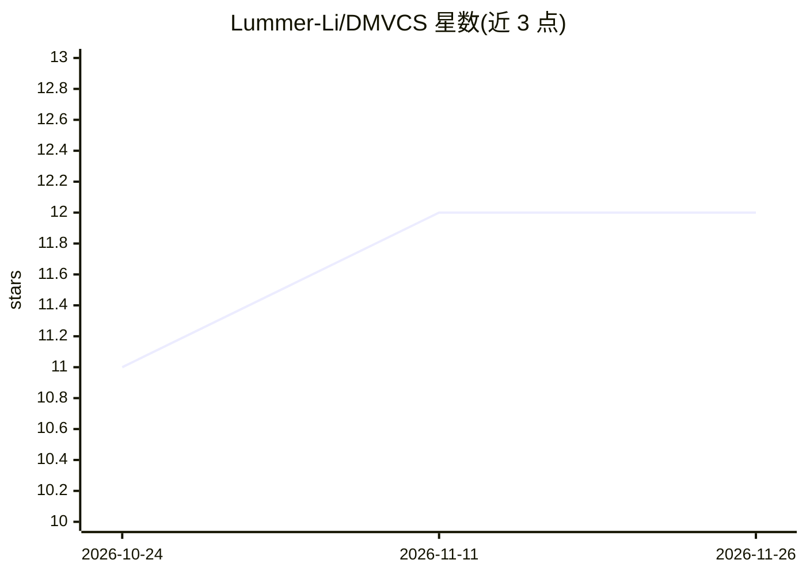

# Lummer-Li/DMVCS

⭐ 12 · Python · Apache-2.0 · 推送 2026-01-22 · [GitHub](https://github.com/Lummer-Li/DMVCS) · 组织维护

**面向研究者的多视图聚类论文官方实现（TKDE 2026）**

DMVCS 论文的官方代码实现，发表于 IEEE TKDE 2026，作者来自北京交通大学与南京邮电大学。方法将每个视图分解为一致性与特异性表示，通过跨组件语义相关性对齐模块、分层采样策略与多跳邻居对比学习，生成可用于聚类的统一表示；训练后用 K-Means 得到预测结果。README 给出十个公开多视图数据集的整理格式、训练入口 main.py 及引用信息。许可声明代码仅限研究与教育用途，商业使用需事先获得正式许可。

## 筛选速览

| 维度 | 判定 | 备注 |
|---|---|---|
| AI 角色 | `ai-native` | 本体是模型或模型工具 |
| 许可风险 | `permissive` | Apache-2.0 |
| 部署形态 | `None` |  |
| 模型依赖 | — | README 未给出锁定关系 |
| 硬件要求 | — | 无带数字的原话,不猜 |
| 安装摩擦 | `low` | 无编译、无系统依赖或容器化 |
| 成熟度 | — | 结构信号不足 |

## 能力要点

- 解耦表示分解：语义一致性最大化与视图间相关性最小化
- 跨组件语义相关性对齐模块配合分层采样策略
- 多跳邻居对比学习扩展正样本范围
- 十个公开多视图数据集的数据组织格式与训练脚本

## 适用场景

- 在 ALOI、Cifar10 等多视图数据集上复现论文聚类实验
- 作为多视图聚类研究的基线实现进行消融对比
- 研究解耦表示与语义相关性保持机制

## 场景标签

`科研工具` · 领域:学习与行业

## 证据(README 行号)

> L1: ✨Disentangled Contrastive Multi-view Clustering via Semantic Relevance Invariance
> L22: **_Abstract -_** The real-world data is relatively complex, generally formed by the interaction of different latent
> L57: - To train the DMVCS, run: `main.py`. The prediction results obtained using the K-Means algorithm.

## 星数曲线

2026-10-24 11 → 2026-11-26 12（+1）

---
*卡片 v1 · prompt 1.4 · 生成 2026-11-18 · 置信度 high · 依据 README sha `fa2f9dabdae6` · [字段定义](../../DATASET.md)*
