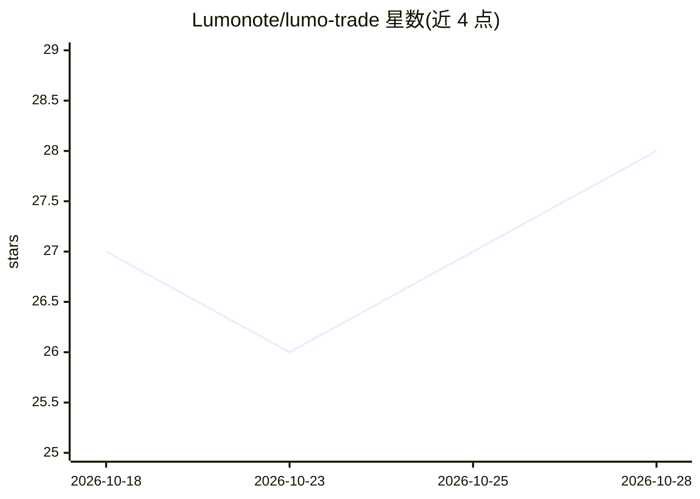

# Lumonote/lumo-trade

⭐ 29 · Python · MIT · 推送 2026-10-23 · [GitHub](https://github.com/Lumonote/lumo-trade) · 个人维护 · 中文 README

**本地优先的 A 股智能投研工作站：行情、量化评分与模拟复盘**

面向 A 股研究、量化实验和投资复盘的桌面/Web 应用，由 Tauri 2 桌面壳与本地 Robyn 服务构成，数据默认存 SQLite 于本机。功能覆盖市场全景、多因子机会挖掘（30 个量化模型）、个股工作台、八维条件选股、风险分层、形态搜股、股指期货与模拟盘复盘。AI 部分包括可选的 Kronos K 线基础模型预测（CPU/CUDA/MPS）与 LLM 个股解读、多空评审团；不自动交易，最终判断由使用者完成。数据源支持 TuShare（部分需积分）及 AKShare 等公开源。

## 筛选速览

| 维度 | 判定 | 备注 |
|---|---|---|
| AI 角色 | `ai-enhanced` | 去掉 AI 部分产品仍成立 |
| 许可风险 | `permissive` | MIT |
| 部署形态 | `desktop` | 安装包/桌面程序 |
| 模型依赖 | — | README 未给出锁定关系 |
| 硬件要求 | — | 无带数字的原话,不猜 |
| 安装摩擦 | `low` | 无编译、无系统依赖或容器化 |
| 成熟度 | — | 结构信号不足 |

## 能力要点

- 30 个量化模型、技术指标与可解释规则引擎构成评分依据
- 机会挖掘引擎拆分为候选、评分、LLM 分析、报告生成等可观察阶段
- 可选 Kronos 金融 K 线预测，支持 CPU/CUDA/Apple MPS
- 本地模拟盘记录委托成交，不触发真实交易

## 适用场景

- 从市场全景到个股深研、模拟执行与复盘的完整本地投研流程
- 按行情、资金、龙虎榜、技术形态等八维条件筛选候选股
- 手绘形态在本地指纹库中检索相似股票并查看后验表现

## 场景标签

`金融量化` · 领域:学习与行业

## 证据(README 行号)

> L16: Lumo Trade 面向 A 股研究、量化实验和投资复盘场景。它不是自动荐股工具：评分、规则、回测和 AI 解读都保留数据依据与风险提示，最终判断由使用者完成。
> L38: - **可选 Kronos 预测**：集成 Kronos 金融 K 线基础模型，支持 CPU、CUDA 和 Apple MPS；预测结果用于研究，不替代规则与风控。
> L196: > 模式本就不含 torch / modelscope —— 数据、机会挖掘和 Web 界面照常可用，只有 Kronos 模型推理类功能不可用。

## 星数曲线

2026-10-18 27 → 2026-10-28 28（+1）

---
*卡片 v1 · prompt 1.4 · 生成 2026-10-26 · 置信度 mid · 依据 README sha `968de01ceba0` · [字段定义](../../DATASET.md)*
