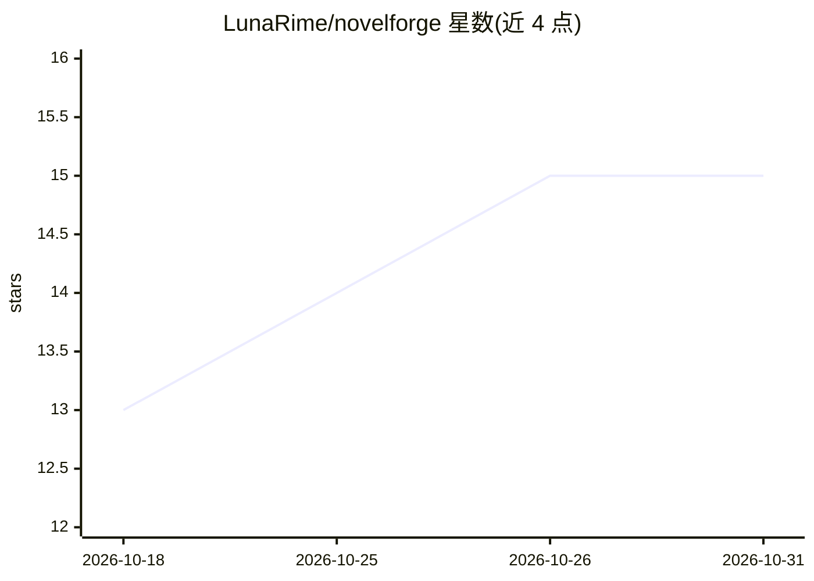

# LunaRime/novelforge

⭐ 15 · TypeScript · GPL-3.0 · 推送 2026-10-28 · [GitHub](https://github.com/LunaRime/novelforge) · [官网](https://github.com/LunaRime/novelforge) · 组织维护 · 中文 README

**为网文作者打造的 AI 小说写作桌面 IDE**

基于 Electron + React 的开源 AI 小说创作 IDE，覆盖大纲生成、流式章节正文、段落级改写、5 角色评审、伏笔管理与后期管线等全流程；内置百万字级本地知识库（LanceDB 向量检索 + jieba 中文全文索引）、作品三级记忆、分层模型路由与 Prompt 缓存等成本优化，以及带 23 个内置工具和 MCP 扩展的 Agent 助手。章节、设定、向量索引全部留在本机。支持 OpenAI/DeepSeek/Gemini/Claude/Ollama/智谱 GLM 等，三语界面；Windows 提供安装包与便携版，macOS/Linux 需源码构建。

## 筛选速览

| 维度 | 判定 | 备注 |
|---|---|---|
| AI 角色 | `ai-native` | 本体是模型或模型工具 |
| 许可风险 | `viral` | GPL-3.0 |
| 部署形态 | `desktop` | 安装包/桌面程序 |
| 模型依赖 | local-ok | 支持本地模型 |
| 硬件要求 | — | 无带数字的原话,不猜 |
| 安装摩擦 | `medium` | 含编译或系统依赖之一 |
| 成熟度 | — | 结构信号不足 |

## 能力要点

- 大纲→细纲→正文→评审→定稿的全流程 AI 工作流（含 5 角色并行评审与加权评分）
- 本地 RAG 知识库：LanceDB 向量检索 + jieba 中文全文索引 + 四级降级链，断网可用
- elite/standard/budget 三层模型路由 + Prompt 缓存的成本优化引擎
- 23 个内置工具 + SKILL.md 技能包 + MCP 扩展的 Agent 助手

## 适用场景

- 网文作者在本机完成从大纲到定稿的 AI 辅助长篇创作
- 管理世界观、角色档案与伏笔并保持跨章一致性
- 通过供应商配置接入多模型并控制创作费用

## 场景标签

`AI 写作` `RAG` · 领域:内容生成

## 证据(README 行号)

> L14: > **NovelForge** 是一款开源、隐私优先的 AI 写作 IDE。将大语言模型驱动的全流程工作流与本地 RAG 知识库深度融合，为作者提供 IDE 级别的沉浸式创作体验。支持 **zh-CN / en-US / ru-
> L46: |流式章节正文生成|单章流式打字机生成，精准响应前文上下文|

## 星数曲线

2026-10-18 13 → 2026-10-31 15（+2）

---
*卡片 v1 · prompt 1.4 · 生成 2026-10-30 · 置信度 high · 依据 README sha `c313793aec95` · [字段定义](../../DATASET.md)*
