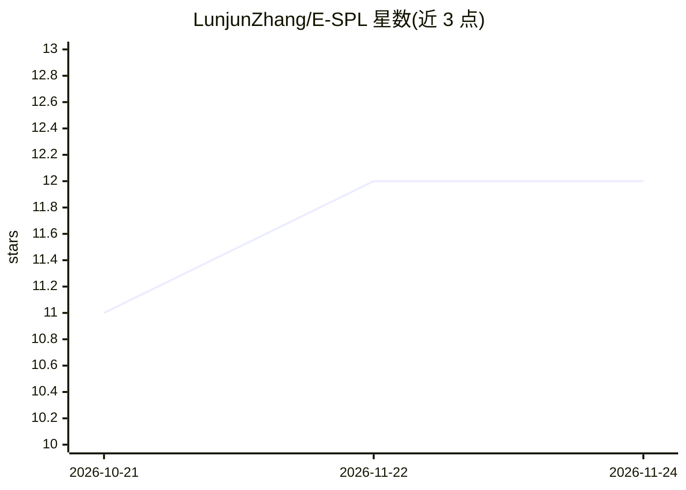

# LunjunZhang/E-SPL

⭐ 12 · Python · MIT · 推送 2026-02-26 · [GitHub](https://github.com/LunjunZhang/E-SPL) · [官网](https://sites.google.com/view/system-prompt-learning/) · 个人维护

**E-SPL 论文代码：演化系统提示与 RL 联合优化 LLM**

论文《Evolutionary System Prompt Learning for Reinforcement Learning in LLMs》的官方实现。方法在每次 RL 迭代中对多个系统提示采样轨迹并做策略梯度，同时通过基于 LLM 自反思的变异与交叉两个遗传算子演化系统提示；提示池用 TrueSkill 贝叶斯评分管理与选择。代码以 tinker-cookbook recipe 形式提供，依赖 Tinker 训练 API，预配置四组数学训练/测试数据集对，实验通过单一入口脚本与 CLI 参数配置。默认基础模型为 DeepSeek-V3.1，需 Tinker API key。

## 筛选速览

| 维度 | 判定 | 备注 |
|---|---|---|
| AI 角色 | `ai-native` | 本体是模型或模型工具 |
| 许可风险 | `permissive` | MIT |
| 部署形态 | `library` | 以包/库形式分发 |
| 模型依赖 | — | README 未给出锁定关系 |
| 硬件要求 | — | 无带数字的原话,不猜 |
| 安装摩擦 | `low` | 无编译、无系统依赖或容器化 |
| 成熟度 | — | 结构信号不足 |

## 能力要点

- 变异与交叉两个基于 LLM 自反思的遗传算子更新系统提示
- TrueSkill 贝叶斯评分跟踪提示质量并支持 uniform/lucb/ucb/softmax 选择策略
- 三种训练模式：联合演化+RL、仅演化、仅 RL
- 四组预配置数学数据集对（AIME/BeyondAIME/DAPO/HMMT）

## 适用场景

- 复现论文中的系统提示演化与 RL 联合训练实验
- 在数学推理数据集上训练并对比不同 train_mode
- 研究发现的系统提示策略（自验证、启发式规则等）

## 场景标签

`强化学习` · 领域:训练与推理

## 证据(README 行号)

> L11: LLMs today primarily self-improve via two mechanisms: *self-reflection* for context updates, and *reinforcement lea
> L37: 2. Install tinker python client via `pip install tinker`

## 星数曲线

2026-10-21 11 → 2026-11-24 12（+1）

---
*卡片 v1 · prompt 1.4 · 生成 2026-11-19 · 置信度 high · 依据 README sha `a52092dc78cc` · [字段定义](../../DATASET.md)*
