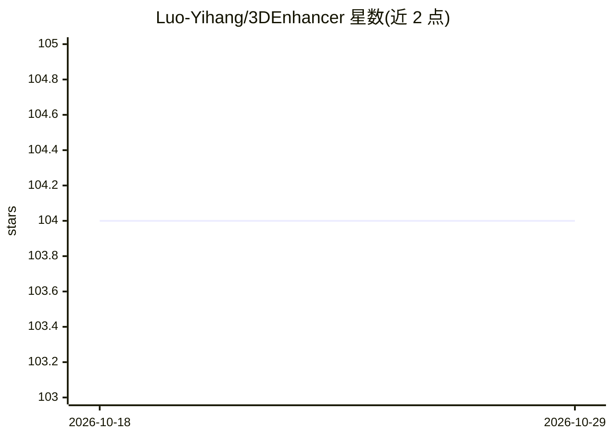

# Luo-Yihang/3DEnhancer

⭐ 104 · Python · NOASSERTION · 推送 2026-05-18 · [GitHub](https://github.com/Luo-Yihang/3DEnhancer) · [官网](https://yihangluo.com/projects/3DEnhancer) · 组织维护

**CVPR 2025 多视角扩散模型：增强低质量多视角图像以提升 3D 模型**

来自南洋理工大学 S-Lab 的 3D 增强研究代码：用多视角潜在扩散模型对粗糙 3D 输入的多视角图像做去噪精修，包含姿态感知编码器、极线聚合的多视角注意力模块，以保持跨视角一致性。通过 git clone + conda + pip 安装，需下载预训练权重，要求显存至少 18GB 的 NVIDIA GPU（已在 A100/V100 测试）。提供推理脚本与 Gradio 网页 demo（可结合 LGM 重建 3D 模型），另有 Hugging Face Spaces 在线 demo。许可证为 NTU S-Lab License 1.0。

## 筛选速览

| 维度 | 判定 | 备注 |
|---|---|---|
| AI 角色 | `ai-native` | 本体是模型或模型工具 |
| 许可风险 | `none` | NOASSERTION |
| 部署形态 | `library` | 以包/库形式分发 |
| 模型依赖 | — | README 未给出锁定关系 |
| 硬件要求 | — | 无带数字的原话,不猜 |
| 安装摩擦 | `medium` | 含编译或系统依赖之一 |
| 成熟度 | — | 结构信号不足 |

## 能力要点

- 多视角潜在扩散模型精修低质量多视角图像
- 姿态感知编码器与极线聚合的多视角注意力保持一致性
- 提供 Gradio demo 并可结合 LGM 重建 3D 模型
- 在 Hugging Face Spaces 提供在线 demo

## 适用场景

- 对低分辨率多视角渲染结果做一致性的画质增强
- 提升 3D 生成/重建管线的输出质量
- 复现 CVPR 2025 论文的实验结果

## 场景标签

`图像视频处理` · 领域:感知与多模态

## 证据(README 行号)

> L37:  In this study, we present a novel 3D enhancement pipeline, dubbed 3DEnhancer , which employs
> L38:  a multi-view latent diffusion model to enhance coarse 3D inputs while preserving multi-view consistency.

## 星数曲线

2026-10-18 104 → 2026-10-29 104（+0）

---
*卡片 v1 · prompt 1.4 · 生成 2026-10-23 · 置信度 mid · 依据 README sha `7e602b3ba860` · [字段定义](../../DATASET.md)*
