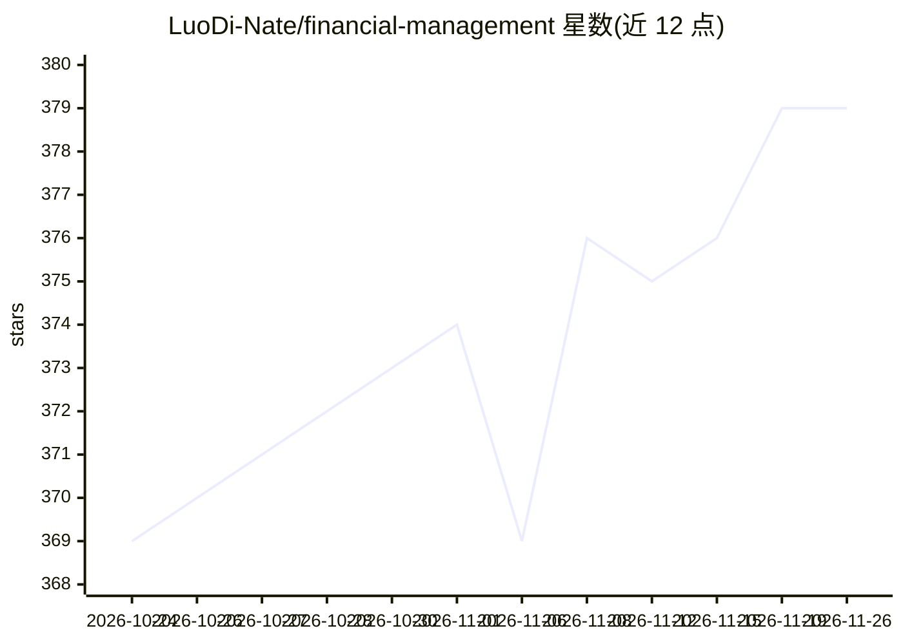

# LuoDi-Nate/financial-management

⭐ 379 · Java · AGPL-3.0 · 推送 2026-11-23 · [GitHub](https://github.com/LuoDi-Nate/financial-management) · [官网](https://beta.dixi-token.top) · 个人维护 · 中文 README

**自托管家庭资产管理：全家资产全局图+真实年化+AI体检**

Spring Boot + MySQL 的自托管 Web 应用，按「月度快照」方式记录散落在银行/支付宝/券商/房产/房贷中的家庭资产，输出净资产趋势、XIRR/TWR 真实年化、CPI/M2 财富水位线与多维透视（含基金穿透到股/债/行业）。AI 部分：截图上传后由视觉大模型识别持仓名称与市值、AI 推荐资产打标、AI 解读四维体检结果（数字由工程计算，LLM 只解读，不荐产品不预测）。以 Docker compose 或 systemd 直装部署，支持 iOS PWA。

## 筛选速览

| 维度 | 判定 | 备注 |
|---|---|---|
| AI 角色 | `ai-enhanced` | 去掉 AI 部分产品仍成立 |
| 许可风险 | `viral` | AGPL-3.0 |
| 部署形态 | `self-host` | docker 或自建部署 |
| 模型依赖 | — | README 未给出锁定关系 |
| 硬件要求 | — | 无带数字的原话,不猜 |
| 安装摩擦 | `low` | 无编译、无系统依赖或容器化 |
| 成熟度 | — | 结构信号不足 |

## 能力要点

- 月度快照记账：每月一次填报，自动算家庭级 XIRR 与资产 TWR
- AI 截图导入持仓：视觉大模型识别「名称+市值」并三态比对确认
- 基金穿透到真实持仓与申万行业，家庭整体汇总行业敞口
- Docker compose 一键部署（amd64+arm64），数据自托管且导出 CSV

## 适用场景

- 把全家散在各渠道的钱汇总成一张净资产全局图
- 区分工资攒的钱和投资赚的钱，看真实年化收益
- 基金持仓穿透看真实行业风险敞口
- FIRE 退休/子女教育等财务目标的三情景预测

## 场景标签

 · 领域:个人财务/财富管理

## 证据(README 行号)

> L107: - **AI 资产体检 + 调仓建议** — 4 维诊断(配置 / 风险 / 流动性 / 收益)+ 具体调仓步骤(「从 X 调 ¥N 到 Y」)· **所有数字工程算好,LLM 只解读,不荐产品、不预测涨跌**
> L100: - **AI 截图智能填报(v1.4)** — 基金/理财/券商大账户里堆着十几支真实持仓、手 key 太累?**咔咔截图上传,视觉大模型识别出每支「名称 + 市值」并自动打标**(资产类型/行业),和已有持仓做左旧右新三态比对
> L54: **✓ 适合** —— 能自己架一台 Linux 服务器 · 钱散在银行 / 支付宝 / 券商 / 房产 / 房贷 · 在意隐私,不想把全家财务交给任何商业 App · 想知道**真实**年化收益(不是 App 给你看的那种)。

## 星数曲线

2026-10-24 369 → 2026-11-26 379（+10）

---
*卡片 v1 · prompt 1.4 · 生成 2026-11-25 · 置信度 high · 依据 README sha `751f34ce07d7` · [字段定义](../../DATASET.md)*
