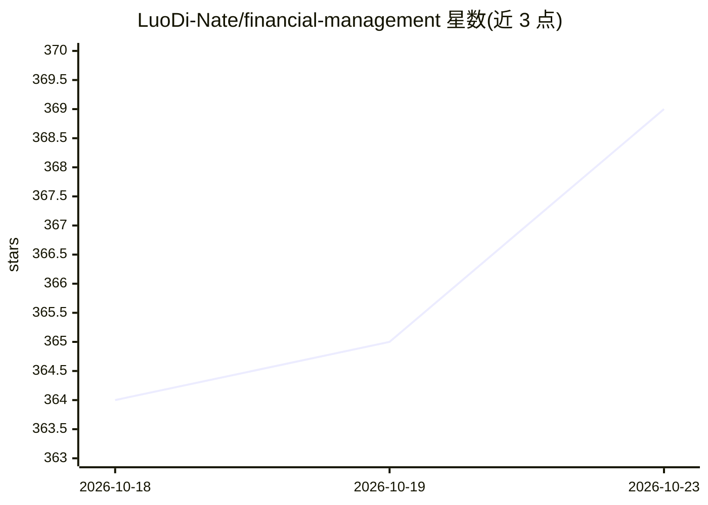

# LuoDi-Nate/financial-management

⭐ 369 · Java · AGPL-3.0 · 推送 2026-10-22 · [GitHub](https://github.com/LuoDi-Nate/financial-management) · [官网](https://beta.dixi-token.top) · 个人维护 · 中文 README

**自托管家庭资产管理应用：月度快照 + XIRR/TWR + AI 体检**

面向中国大陆家庭的自托管资产管理 Web 应用（Spring Boot 3.3 + Java 21 + MySQL 8 + Thymeleaf/HTMX，无 SPA）。按「月度快照 + 外部现金流」模式记账，支持 10 类账户、按成员归集家庭净资产、账户/家庭级 XIRR 与 TWR、CPI 购买力线与 M2 财富线、基金穿透到申万行业、持仓自动拉价与多币种。AI 用于：截图识别持仓（名称+市值，复用用户自有通义千问 key）、LLM 解读工程算好的体检数字（不荐产品不预测）、打标推荐。Docker compose 一键部署，最低 1 GB 内存。限制：非逐笔记账、无券商下单、需自部署。

## 筛选速览

| 维度 | 判定 | 备注 |
|---|---|---|
| AI 角色 | `ai-enhanced` | 去掉 AI 部分产品仍成立 |
| 许可风险 | `dual` | AGPL-3.0 |
| 部署形态 | `self-host` | docker 或自建部署 |
| 模型依赖 | — | README 未给出锁定关系 |
| 硬件要求 | — | 无带数字的原话,不猜 |
| 安装摩擦 | `low` | 无编译、无系统依赖或容器化 |
| 成熟度 | — | 结构信号不足 |

## 能力要点

- 月度快照模式，夫妻异步填报，每月约 10 分钟
- 账户级/家庭级 XIRR + TWR，区分「人赚的」与「钱赚的」
- AI 截图导入持仓：视觉模型识别每支名称+市值，三态比对确认
- 基金穿透到股/债/现金+申万行业，家庭整体行业敞口汇总

## 适用场景

- 把散在银行/支付宝/券商/房产的全家资产合成一张全局图
- 算扣通胀后的真实年化收益（XIRR/TWR）
- 用 AI 截图快速录入基金/券商大账户的十几支持仓
- 按月做家庭资产体检与调仓参考

## 场景标签

 · 领域:个人/家庭财务管理

## 证据(README 行号)

> L4: > 算得出真实年化、分得清「人赚的」和「钱赚的」;大账户手 key 太累?**AI 截图一拍就把每支真实持仓识别拆开**;
> L101: - **AI 截图智能填报(v1.4)** — 基金/理财/券商大账户里堆着十几支真实持仓、手 key 太累?**咔咔截图上传,视觉大模型识别出每支「名称 + 市值」并自动打标**(资产类型/行业),和已有持仓做左旧右新三态比对
> L108: - **AI 资产体检 + 调仓建议** — 4 维诊断(配置 / 风险 / 流动性 / 收益)+ 具体调仓步骤(「从 X 调 ¥N 到 Y」)· **所有数字工程算好,LLM 只解读,不荐产品、不预测涨跌**

## 星数曲线

2026-10-18 364 → 2026-10-23 369（+5）

---
*卡片 v1 · prompt 1.4 · 生成 2026-10-22 · 置信度 high · 依据 README sha `2f58e1ab2279` · [字段定义](../../DATASET.md)*
