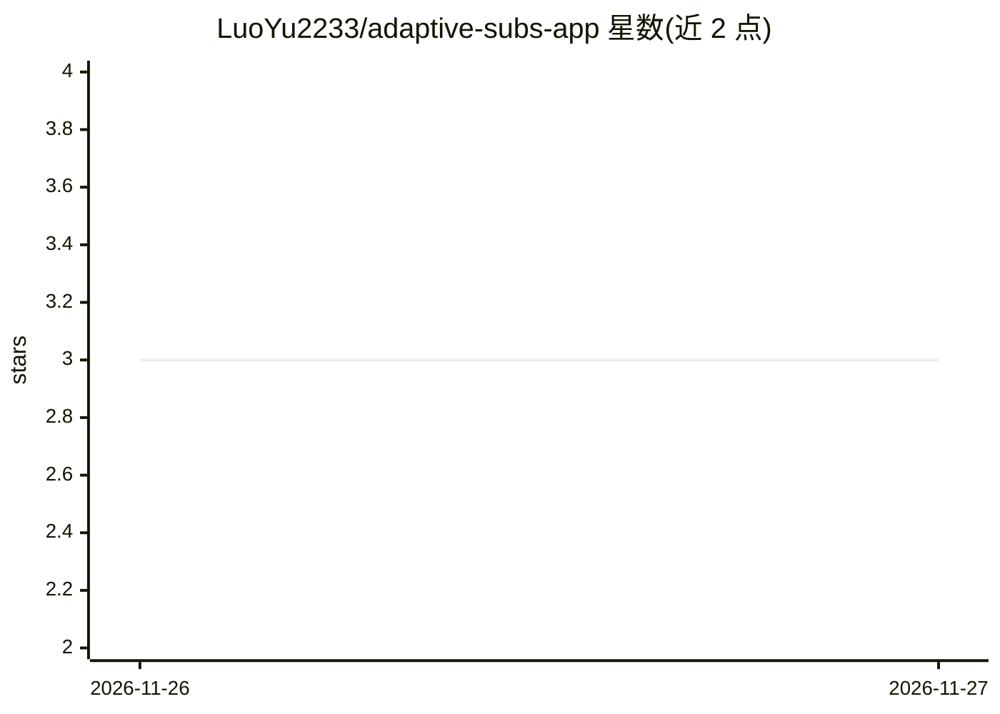

# LuoYu2233/adaptive-subs-app

⭐ 3 · Python · MIT · 推送 2026-11-25 · [GitHub](https://github.com/LuoYu2233/adaptive-subs-app) · [官网](https://luoyu2233.github.io/adaptive-subs/) · 个人维护 · 中文 README

**英语视频学习工具：只给不认识的词标中文注释**

由本地 Windows 程序与 Chrome/Edge 浏览器插件组成：在 B 站与 YouTube 播放器上显示纯英文字幕，并通过 LLM 只给用户可能不认识的单词、短语与熟词僻义标注中文注释。先通过考试成绩与自适应词汇测试生成个人熟词库，再结合上下文决定注释内容；支持点词查询、按 Z 临时看中文翻译、语音识别生成无字幕视频的英文文本，注释模型可选 DeepSeek / 小米 MiMo / OpenAI，使用用户自己的 API key，数据保存在本机。

## 筛选速览

| 维度 | 判定 | 备注 |
|---|---|---|
| AI 角色 | `ai-native` | 本体是模型或模型工具 |
| 许可风险 | `permissive` | MIT |
| 部署形态 | `desktop` | 安装包/桌面程序 |
| 模型依赖 | — | README 未给出锁定关系 |
| 硬件要求 | — | 无带数字的原话,不猜 |
| 安装摩擦 | `low` | 无编译、无系统依赖或容器化 |
| 成熟度 | — | 结构信号不足 |

## 能力要点

- 考试成绩+3 分钟词汇测试生成个人熟词库，按水平注释
- 结合上下文标注短语、习语与熟词僻义
- 语音识别生成英文字幕，被接口拒绝的句子由本机模型补上
- key 与生成数据仅存本机，程序只在本机 127.0.0.1 运行

## 适用场景

- 通过看 B 站/YouTube 英文原声视频沉浸式学英语
- 填四六级/考研/雅思等成绩后按自身水平获得字幕注释
- 给没有英文字幕的视频做语音识别字幕并注释

## 场景标签

`语音识别` · 领域:感知与多模态

## 证据(README 行号)

> L26: Adaptive Subs 提出了一种新方法：**字幕整句都是英文，只在你可能不认识的单词、短语和"熟词僻义"上方标一个简短的中文**。它先通过考试成绩和词汇测试了解你的水平，再结合每句话的上下文判断该标哪些词、该怎么解释。
> L35: - **没有英文字幕也能用**：语音识别生成英文字幕，边下载边识别，几秒钟出第一句；被接口审核拒绝的句子由本机模型补上

## 星数曲线

2026-11-26 3 → 2026-11-27 3（+0）

---
*卡片 v1 · prompt 1.4 · 生成 2026-11-26 · 置信度 mid · 依据 README sha `27efbf95a7c5` · [字段定义](../../DATASET.md)*
